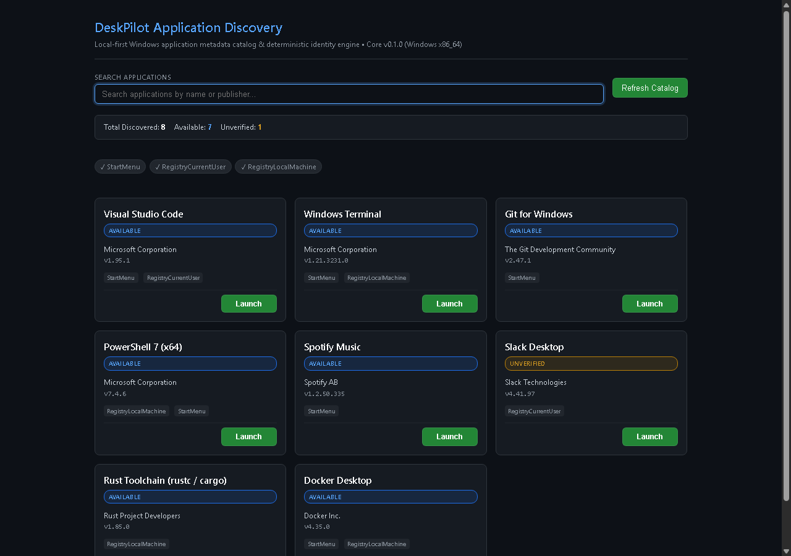

# DeskPilot (Not Done Yet...)

<div align="center">

-0078D6?style=for-the-badge&logo=windows&logoColor=white)


<p align="center">
  <strong>A high-performance, local-first Windows command center built for privacy, determinism, and speed.</strong>
</p>

</div>

---

## Overview

**DeskPilot** is an open-source, technically disciplined command center and launcher engineered natively for Windows. It provides lightning-fast application indexing, sub-millisecond search, safe Win32 execution, and system control without telemetry, cloud dependencies, or background tracking.

Built on **Tauri 2**, **Rust**, and **React 19**, DeskPilot pairs native Win32 performance with modern UI ergonomics while enforcing defense-in-depth isolation boundaries between the web presentation layer and host operating system privileges.

---

## Preview

### Application Discovery Catalog
Discovers applications across Windows Registry hives and Start Menu hierarchies with provenance tracking, operational availability badges, and secure launch controls.



### Real-Time Deterministic Search & Ranking
Sub-millisecond filtering utilizing a four-tier ranking hierarchy (exact match, prefix match, substring match, and publisher metadata) with keyboard-first navigation.


---

## Core Capabilities

### 🔍 Deterministic Windows Application Discovery
- **Multi-Hive Registry Enumeration:** Exhaustively indexes 64-bit (`KEY_WOW64_64KEY`) and 32-bit (`KEY_WOW64_32KEY`) system software keys across `HKEY_LOCAL_MACHINE` and `HKEY_CURRENT_USER`.
- **Start Menu Hierarchy Scanner:** Traversing both Common (`C:\ProgramData\Microsoft\Windows\Start Menu\Programs`) and Per-User Start Menu directories.
- **128-bit Collision-Resistant Application Identity:** Deterministic SHA-256 identity generation (`app_<32-hex>`) incorporating normalized publishers, application titles, and target paths to eliminate duplicate merge collisions.
- **Availability State Engine:** Continuously tracks target executables and categorizes entries into `Available`, `Unverified`, `IncompleteMetadata`, and `MissingTarget`.

### 🛡️ Memory-Safe MS-SHLLINK Shortcut Parser
- Handcrafted, memory-safe binary parser complying with Microsoft Shell Link specification (`[MS-SHLLINK]`).
- Strict Shell Link Header CLSID verification (`00021401-0000-0000-C000-000000000046`).
- Checked offset arithmetic and bounded file reads (64 KB ceiling) protecting against malicious link-bomb attacks.
- Robust decoding supporting both legacy Windows-1252 ANSI strings and modern UTF-16LE Unicode paths.

### ⚡ Secure Win32 Native Launcher
- **Direct Win32 API Invocation:** Spawns processes directly via Windows `CreateProcessW` without intermediate shell interpreters (`cmd.exe` or `powershell.exe`), eliminating command injection vulnerabilities.
- **Safe Working Directory Binding:** Resolves working directories to target executable parent directories or system roots, preventing DLL hijacking in shared folders.
- **Process Isolation:** Detaches launched applications into independent process trees without inheriting privileged handles.

### 🔌 Strongly Typed, Least-Privilege IPC Boundary
- **Opaque ID Addressing:** The frontend presentation layer only holds opaque application IDs (`app_<hex>`) and never handles raw filesystem paths, executable arguments, or environment variables.
- **Input Guard Validation:** Rigorous backend validation rejecting malformed identifiers, invalid UTF-8 sequences, and forbidden payload structures.
- **Safe Serialization:** Structured error envelopes ensuring system path leaks do not reach frontend error toasts.

### 🪟 Desktop Lifecycle & System Tray Integration
- **Single-Instance Enforcement:** Automatically detects secondary launches, forwards focus signals, and summons the primary instance without spawning duplicate processes.
- **Native System Tray:** Lives quietly in the Windows notification area with a native context menu (`Show DeskPilot`, `Hide DeskPilot`, `Quit DeskPilot`).
- **Predictable Hide-to-Tray:** Window close events (`X`) gracefully hide the window to the tray while preserving warm state and catalog indices; explicit quit terminates cleanly.
- **Ergonomic Window Constraints:** Configured with a default dimension of 960×680 and strict minimum bounds of 520×450 to guarantee consistent UI layout.

---

## Architecture

```text
┌────────────────────────────────────────────────────────┐
│               Frontend Presentation Layer              │
│               React 19 • TypeScript • Vite             │
│   • ApplicationCatalog        • Search & 4-Tier Rank   │
│   • ApplicationCard           • Keyboard Navigation    │
│   • LaunchButton (Feedback)   • Real-Time Status Badges│
└───────────────────────────┬────────────────────────────┘
                            │
               Typed Tauri 2 IPC Boundary
         (Domain Intents & Opaque Application IDs)
                            │
┌───────────────────────────▼────────────────────────────┐
│                Rust Backend Core (Kernel)              │
│                                                        │
│  ┌───────────────────────┐   ┌──────────────────────┐  │
│  │   Security Kernel     │   │  Application Catalog │  │
│  │ • Input Guard         │   │ • Generational Cache │  │
│  │ • Path Bounds Checker │   │ • RwLock Concurrency │  │
│  └───────────────────────┘   └──────────────────────┘  │
│  ┌───────────────────────┐   ┌──────────────────────┐  │
│  │   Discovery Engine    │   │   System Tray & Win  │  │
│  │ • Registry Scanners   │   │ • Single-Instance    │  │
│  │ • MS-SHLLINK Parser   │   │ • Intercepted Close  │  │
│  └───────────────────────┘   └──────────────────────┘  │
└───────────────────────────┬────────────────────────────┘
                            │ Direct Win32 APIs
┌───────────────────────────▼────────────────────────────┐
│                 Windows 10 / 11 Native                 │
│  • Advapi32 (Registry)       • Shell32 (Shortcuts)     │
│  • Kernel32 (CreateProcessW) • User32 (Tray & Window)  │
└────────────────────────────────────────────────────────┘
```

---

## Security Model & Invariants

DeskPilot is designed around strict defense-in-depth principles:

1. **Least-Privilege Web View:** WebView2 operates with restricted permissions. Direct filesystem APIs, shell execution, and Node.js primitives are completely disabled.
2. **Path Traversal Guard:** Any filesystem access strictly sanitizes relative segments (`..`, `.\`, `%TEMP%`) and normalizes paths before verification.
3. **No Shell Intermediate:** Launch commands are never formatted as string shell scripts. Process creation bypasses shell parsing entirely.
4. **Local Data Sovereignty:** No network calls are made during indexing or launching. Zero analytics, telemetry, or user tracking exist in the codebase.

---

## Development & Build

### Prerequisites

| Component | Minimum Version | Recommended |
|---|---|---|
| **OS** | Windows 10 (64-bit) | Windows 11 Build 22631+ |
| **Node.js** | Node.js v20+ | Node.js v22+ LTS |
| **Rust** | Rust 1.80+ | Rust MSVC Toolchain (`x86_64-pc-windows-msvc`) |
| **C++ Build Tools** | Visual Studio Build Tools 2022 | MSVC v143 / Windows 10/11 SDK |
| **WebView2** | Evergreen Runtime | Pre-installed on Windows 10/11 |

### Setup & Commands

All commands can be run via PowerShell or Command Prompt. Use `npm.cmd` on Windows if PowerShell execution policies restrict script execution:

```powershell
# Clone the repository
git clone https://github.com/youssefmanssouri/deskpilot-.git
cd deskpilot-

# Install frontend dependencies
npm.cmd install

# Type-check TypeScript and build the production web bundle
npm.cmd run build

# Run frontend test suite (62 tests across 7 suites)
npm.cmd test -- --run

# Launch full desktop application in development mode (with hot reload)
npm.cmd run tauri dev
```

---

## Automated Verification Suite

DeskPilot features a comprehensive suite of **205 automated tests** across both frontend and native backend layers:

### Frontend Test Breakdown (Vitest)
- `ApplicationCatalog.test.tsx` (13 tests): Discovery loading, error states, keyboard navigation, empty state handling, and refresh lifecycles.
- `interaction.test.tsx` (13 tests): Keyboard-first arrow navigation, quick-select, focus traps, and modal controls.
- `LaunchButton.test.tsx` (12 tests): Launch invocation, pending state, success confirmation reset, error recovery, and timer unmount hygiene.
- `discovery.test.ts` (8 tests): Typed IPC contract validation for application discovery and payload integrity.
- `launcher.test.ts` (6 tests): Launch IPC contract validation and error mapping.
- `ApplicationCard.test.tsx` (6 tests): Card rendering, availability badge states, publisher provenance display.
- `ipc.test.ts` (4 tests): Typed error serialization and boundary protection.

### Backend Test Breakdown (Cargo / Rust)
- Application discovery across registry hives and Start Menu directories.
- MS-SHLLINK binary parser boundary checks, CLSID validation, and malformed header rejection.
- Secure Win32 process creation and argument isolation.
- Single-instance mutex validation and second-instance summon mechanics.
- System tray action dispatching, tooltip configuration, and hide-to-tray lifecycle invariants.
- Thread-safe generational catalog cache concurrency under `RwLock`.

---

## Project Roadmap

- [x] **Phase 1:** Architectural Foundation & Security Baseline
- [x] **Phase 2:** Hardened Discovery Engine & Registry Scanner
- [x] **Phase 3:** MS-SHLLINK Binary Parser & Application Identity
- [x] **Phase 4:** Win32 Secure Launcher, Typed IPC & Catalog Integration
- [x] **Phase 5.1:** Window Lifecycle Hardening, Single-Instance & 4-Tier Search Ranking
- [x] **Phase 5.2:** Native System Tray & Summon Integration
- [ ] **Phase 6:** Safe Local File Operations (Recycle Bin Integration & Rollback Ledgers)
- [ ] **Phase 7:** SQLite Persistence & Operation Audit Trail
- [ ] **Phase 8:** System Resource Monitoring & Health Metrics

---

## License

This project is licensed under the [MIT License](LICENSE).
