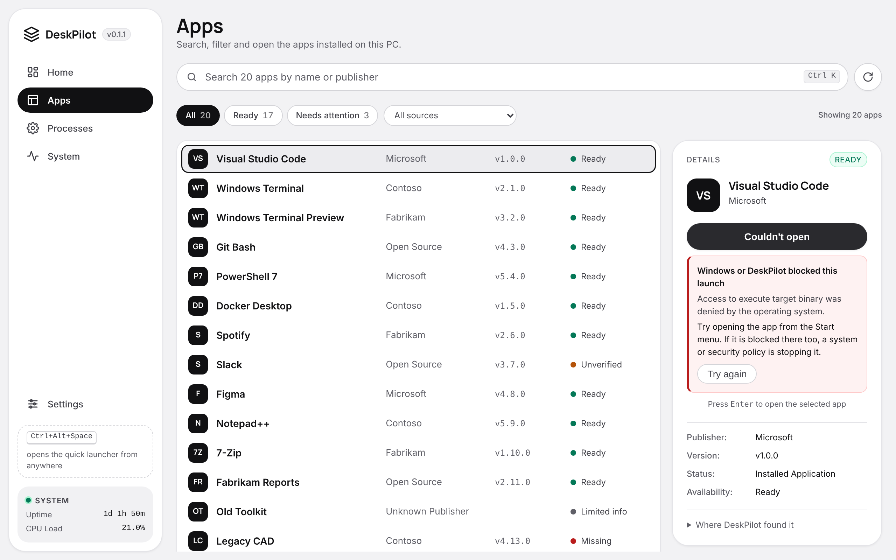
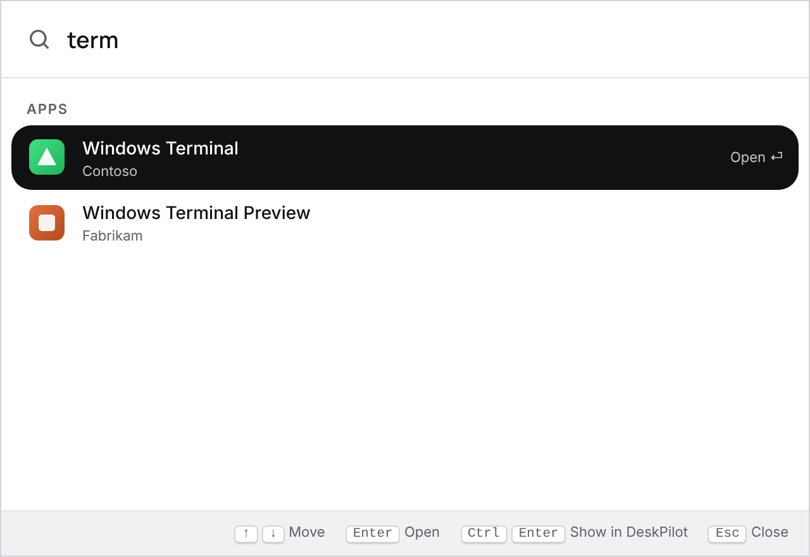
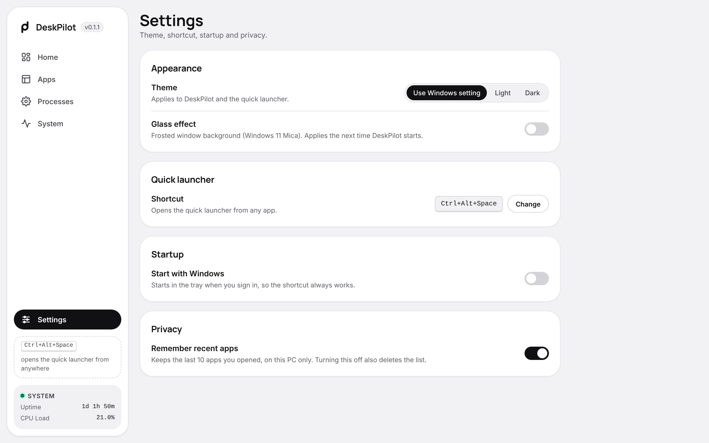
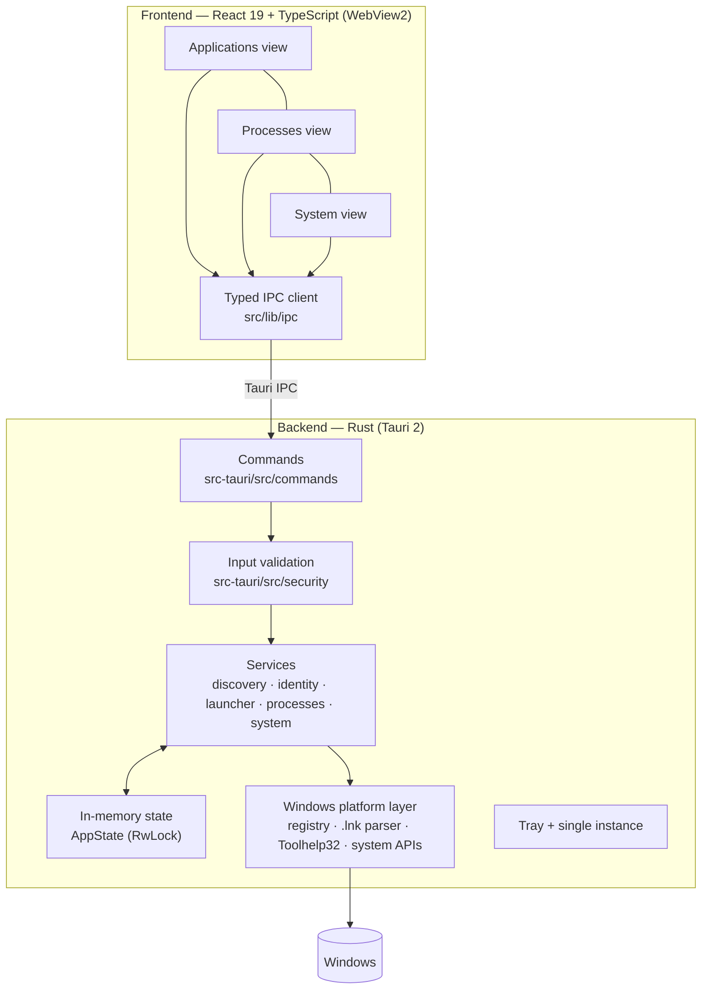

<p align="center">
  
</p>

<h1 align="center">DeskPilot</h1>

<p align="center">
  <strong>A local-first Windows desktop command center: find and launch installed applications, inspect running processes, and monitor system resources — without accounts, cloud services, or telemetry.</strong>
</p>

<p align="center">
  
  
  
</p>

> [!IMPORTANT]
> **v0.1.1 is a developer preview release.** Release binaries are **unsigned**, and source/release evaluation is intended for technical evaluation and developer testing on Windows 11 Pro 25H2. **Note on publication status:** the currently published GitHub Release is the earlier `v0.1.1-preview.2` release; the newer verified build (`effdb09971edf4746e0388fe714564ce477ee6a5`, GitHub Actions run `45693205561`) has **not yet been published** as a GitHub Release (workflow artifacts are temporary CI outputs, not permanent public downloads). DeskPilot has **not been tested on physical or virtual Windows 10 desktop hardware** (the exact minimum supported Windows 10 build is undetermined). Users may encounter *Unknown publisher* or SmartScreen warnings, and warning-free installation is not promised. If your policy requires signed binaries or blocks unsigned code, consult your system administrator. See [Known limitations](#known-limitations) before use.

---

## Contents

- [Status at a glance](#status-at-a-glance)
- [Visual preview](#visual-preview)
- [Features](#features)
- [What DeskPilot does not do](#what-deskpilot-does-not-do)
- [System requirements](#system-requirements)
- [Installation](#installation)
- [Public preview testing](#public-preview-testing)
- [Privacy and network behavior](#privacy-and-network-behavior)
- [Security model](#security-model)
- [Architecture](#architecture)
- [Testing and validation](#testing-and-validation)
- [Building from source](#building-from-source)
- [Known limitations](#known-limitations)
- [Roadmap](#roadmap)
- [Contributing](#contributing)

---

## Status at a glance

| Area | Status |
| :--- | :--- |
| Version | `0.1.1` unsigned developer preview (commit `effdb09971edf4746e0388fe714564ce477ee6a5`) |
| Code signing | Not signed. Unsigned Developer Preview; SHA-256 checksums and build provenance (`build-manifest.json`) are provided for integrity verification. |
| Public download | The latest published GitHub Release is the earlier `v0.1.1-preview.2` tag. The newer verified build (`effdb099`, run `45693205561`) has not yet been published as a GitHub Release. |
| Windows 11 x64 | **Physical desktop runtime acceptance validated** on Windows 11 Pro 25H2 (build `26200.9974`, Phase 18.4). All 15 permitted functional acceptance checks passed, including elevated MSI upgrade with preserved settings/history, 137 apps discovered, safe Win32 launch (`About Java`), Process Monitor, System Intelligence, `--autostart` tray launch, single-instance mutex, guarded startup states (`Disabled`, `Enabled`, `Stale`, `OtherInstall`, `Unrecognized`), and a 31-minute runtime observation without crashes or unexpected resource growth (`26.24 -> 23.48 MB` working set). (In isolated Windows 11 Enterprise Build 26100 Windows Sandbox testing, execution was blocked by container hypervisor WDAC policy `VerifiedAndReputableDesktop`). |
| Windows 10 x64 | **Untested on physical or virtual desktop hardware.** Exact minimum supported Windows 10 build is undetermined; empirical validation pending. (Windows 7, 8, and 8.1 are outside the intended support scope). |
| Windows Server 2022 (`windows-2022`) | Automated CI smoke test only (`installer-smoke-test.yml`, run `45692834602`: silent MSI install, 20-second process launch check, uninstall). Provides CI installer smoke-test evidence only, not desktop Windows compatibility evidence. |
| Windows on ARM64 | Not built, not tested. |
| Clean-machine install lifecycle | Elevated MSI upgrade, public shortcut placement (`%PUBLIC%\Desktop` and `%PROGRAMDATA%\...`), and retention of existing user data outside the MSI removal scope observed on physical Windows 11 Pro 25H2 (Phase 18.4); silent install/20s-run/uninstall smoke-tested on CI Windows Server 2022 (`45692834602`). Windows 10 physical or virtual desktop validation remains pending. |
| Automated tests | 511 total (260 Rust + 251 frontend) headless unit/integration tests; CI (`45692834705`), Installer Smoke Test (`45692834602`), CodeQL (`45692835764`), and Release Build (`45693205561`) passed. See [Testing and validation](#testing-and-validation). |

---

## Visual Preview

The captures below are real Windows screenshots of DeskPilot, with installed applications and real icons, captured on Windows via the [Real screenshots](.github/workflows/screenshots.yml) workflow.








---

## Features

DeskPilot combines a modern, monochrome command center with low-level Windows integration across four primary interfaces: **Home**, **Applications**, **Processes**, and **System Intelligence**, supplemented by a global **Quick Launcher** and **System Tray** presence.

### Home: overview and quick actions
- **PC Summary:** Host system health, active Windows build, and real-time CPU and memory telemetry sparklines.
- **Recent Apps:** Shows recently launched applications with direct one-click or keyboard relaunching (stored locally in `launch-history.json`, disabled or cleared anytime).
- **Needs Attention:** Proactive status flags for unverified targets or partial catalog read warnings.

### Applications: discovery, search, and safe launch
- **Discovery Sources:** Reads installed-application metadata from:
  - `HKLM\Software\Microsoft\Windows\CurrentVersion\Uninstall` (64-bit view)
  - `HKLM\Software\Wow6432Node\Microsoft\Windows\CurrentVersion\Uninstall` (32-bit view)
  - `HKCU\Software\Microsoft\Windows\CurrentVersion\Uninstall`
  - Common Start Menu (`%ProgramData%\Microsoft\Windows\Start Menu\Programs`) and per-user Start Menu (`%APPDATA%\Microsoft\Windows\Start Menu\Programs`) `.lnk` shortcuts
- **Memory-Safe Shortcut Parsing:** `.lnk` files are parsed by a bounded binary parser (64 KiB read limit, Shell Link CLSID check, UTF-16LE and ANSI path support). No COM or shell handlers are invoked, and nothing is executed during discovery.
- **Deduplication with Stable IDs:** Entries found across multiple sources are merged under a deterministic `app_<32 hex>` identifier (first 128 bits of SHA-256 over normalized publisher, name, and executable metadata).
- **Availability States:** Each entry is classified as `Available`, `Unverified`, `IncompleteMetadata`, or `MissingTarget`. Overlapping scans are prevented.
- **Real Application Icons:** Reads native 64×64 32bpp RGBA icons directly from `.exe` resources via Win32 Shell APIs (`SHDefExtractIconW`), rendered via HTML5 canvas. Packaged Windows Store app execution aliases gracefully display clean two-letter monogram fallback badges.
- **Search & Filter:** Instant keyboard-first filtering ranked in four tiers (exact name → prefix → substring → publisher). `Ctrl+K` focuses search, arrow keys move selection, `Enter` launches, `Esc` clears.
- **Safe Launching:** Target must be an existing local `.exe` (UNC, device, and temp/Downloads paths rejected); started directly with Rust's `std::process::Command` without shell interpretation.

### Quick Launcher (`Ctrl+Alt+Space`)
- Borderless, centered floating palette accessible globally from any Windows application via customizable hotkey (`Ctrl+Alt+Space`).
- Win32 `SetForegroundWindow` activation and 400ms dismissal grace period to ignore transient creation blur events.
- Type to search apps, arrow keys to navigate, `Enter` to launch, `Ctrl+Enter` to inspect in DeskPilot, `Esc` to clear query or close.

### Processes: strictly read-only monitor
- Enumerates running processes with a Toolhelp32 snapshot on a dedicated background worker pool.
- Shows PID, parent PID, name, executable path, start time, working-set memory, session ID, and cumulative CPU time.
- Queries each process with `PROCESS_QUERY_LIMITED_INFORMATION` only.
- **Strictly read-only:** DeskPilot cannot end, suspend, or modify processes; zero process termination or modification code exists in the application.

### System Intelligence
- **CPU:** System-wide utilization calculated from successive `GetSystemTimes` samples.
- **Memory:** Physical RAM total, available, and in-use (`GlobalMemoryStatusEx`).
- **Storage:** Fixed drives only (`GetDriveTypeW` = fixed; optical and network shares excluded).
- **Uptime:** Monotonic system uptime (`GetTickCount64`) and session duration.
- Configurable refresh interval: manual, 3 s, or 5 s.

### Settings & Local Preferences
- Monochrome UI theme selection: Light, Dark, or System matching.
- Quick Launcher global shortcut configuration.
- Optional "Start with Windows" per-user startup entry (`HKCU\...\Run`).
- Recent apps history toggle (clearing history deletes `launch-history.json`).
- Windows 11 Mica glass effect toggle (`supports_glass` guards against non-Windows 11 hosts).

### Desktop Integration

- **Single Instance:** Launching DeskPilot again forwards focus to the existing window (via 	auri-plugin-single-instance).
- **System Tray:** Notification area menu with *Show DeskPilot*, *Hide DeskPilot*, and *Quit DeskPilot*. Closing the window hides to tray; *Quit* exits.
- Window bounds: default 960×680, minimum 520×450.

<!--
Screenshots: The redesign_*.png images are real captures of the current build on a
GitHub Actions Windows runner (see .github/workflows/screenshots.yml).
-->

---

## What DeskPilot does not do

To set accurate expectations for this preview:

- **No process termination**, suspension, or priority changes. DeskPilot is strictly a monitor, not a task killer.
- **No cloud accounts, sync, or telemetry** — all state is local; settings and launch history live in `%APPDATA%\com.deskpilot.app` (`settings.json` and `launch-history.json`) and can be disabled or deleted anytime.
- **No Microsoft Store manifest parsing** — packaged execution aliases display clean two-letter monogram cards rather than extracting Appx manifests.
- **No launch arguments**, no "run as administrator", no launching from Downloads or temp folders.
- **No auto-update mechanism.**
- **No ARM64 build.**

---

## System requirements

| Requirement | Details |
| :--- | :--- |
| Operating system | Intended target: 64-bit Windows (`x86_64`). Desktop runtime validated on **Windows 11 Pro 25H2**. **Windows 10 x64** has not been tested on physical or virtual desktop hardware (minimum supported Windows 10 build is undetermined). Windows 7, 8, 8.1, and Windows on ARM64 are outside scope. |
| WebView2 Runtime | Microsoft Edge WebView2 (Evergreen). Included by default on Windows 11; if missing on a target system, the installer runs the embedded bootstrapper — see below. |
| Install permissions | Administrator rights (the MSI installs per-machine). |
| Security policy | Your system must permit running **unsigned** software. Hosts enforcing Smart App Control or App Control for Business may block DeskPilot. |

---

## Installation

> [!NOTE]
> The latest published GitHub Release is the earlier `v0.1.1-preview.2` preview. The newer verified v0.1.1 build (`effdb099`, run `45693205561`) has not yet been published to GitHub Releases. This section documents the behavior of the v0.1.1 MSI for evaluators and for anyone building the installer from source.

### Installer behavior

- **Package:** `deskpilot_0.1.1_x64_en-US.msi` (WiX v3.14), per-machine install (`ALLUSERS=1`) to `C:\Program Files\deskpilot`.
- **Creates:** Public desktop shortcut (`%PUBLIC%\Desktop\DeskPilot.lnk`), Common Start Menu shortcut (`%ProgramData%\Microsoft\Windows\Start Menu\Programs\DeskPilot\DeskPilot.lnk`), an uninstall shortcut in the Start Menu folder, and one *Installed apps* entry. Erroneous legacy paths (`C:\Desktop`, `C:\deskpilot`) are completely eliminated.
- **Tested (Physical Windows 11 Host, Phases 16.38 & 18.4; Windows Sandbox, Phase 16.29; CI, Windows Server 2022):** Elevated in-place major upgrade (`msiexec /i ...`), public shortcut creation, single ARP registration, installed executable execution, and retention of existing user data were observed on **Windows 11 Pro 25H2** (build `26200.9974` in Phase 18.4; earlier preview in Phase 16.38). In **Windows 11 Enterprise Build 26100 Windows Sandbox** (Phase 16.29), MSI installer lifecycle passed while container WDAC policy blocked unsigned binary execution. GitHub Actions **Windows Server 2022** (`windows-2022`, `installer-smoke-test.yml`, run `45692834602`) provides automated installer smoke-test evidence (silent install, 20-second startup check, and uninstall), not desktop Windows compatibility evidence.

### Windows File Explorer installation walkthrough

For evaluators and testers installing DeskPilot via the Windows graphical shell:

1. **Download and Checksum Verification:** Download the MSI from [GitHub Releases](https://github.com/youssefmanssouri/deskpilot-/releases) and verify its SHA-256 against the checksums published on that specific release (for example, `v0.1.1-preview.2` has its own published checksums). For the newer `effdb09971edf4746e0388fe714564ce477ee6a5` candidate build (run `45693205561`, not yet published to GitHub Releases), `Get-FileHash .\deskpilot_0.1.1_x64_en-US.msi -Algorithm SHA256` must match `b6e4001f44a9c05d7577e33ba0fab6ffa99b68e9e099b3a56d56d337e5dfd29f`.
2. **File Explorer Execution:** Double-click `deskpilot_0.1.1_x64_en-US.msi` in File Explorer.
3. **Microsoft Defender SmartScreen and Code Integrity:** Because preview binaries are unsigned (`NotSigned`), Windows Defender SmartScreen or system application control policies may present a warning:

   *"Windows protected your PC — Microsoft Defender SmartScreen prevented an unrecognized app from starting."*

   Do not bypass, override, or disable security warnings or application control policies. If Windows or your organizational security policy blocks execution, **stop installation immediately**. Do not attempt to bypass restrictions by building from source: locally compiled binaries remain unsigned and are subject to the same application-control policies. Source evaluation is appropriate only in environments where you are explicitly permitted to build and run unsigned software. If your environment requires signed software, consult your system administrator.
4. **User Account Control (UAC) Elevation:** If permitted by system policy, Windows will display a UAC elevation prompt requesting administrative permission for the Windows Installer. Click **Yes** to complete the per-machine installation into `C:\Program Files\deskpilot\`.
5. **Shortcuts & First Launch:** Setup registers:
   - Desktop shortcut: `%PUBLIC%\Desktop\DeskPilot.lnk`
   - Start Menu shortcut: `%ProgramData%\Microsoft\Windows\Start Menu\Programs\DeskPilot\DeskPilot.lnk`

   Launch DeskPilot from either shortcut.

> [!WARNING]
> **Do not bypass or disable security protections.** Never bypass security warnings or disable Microsoft Defender SmartScreen, Smart App Control, or organizational Application Control policies (such as WDAC) to run DeskPilot. If your environment blocks unsigned installers, stop installation immediately. Building from source is not a workaround for application-control restrictions, as locally built binaries remain unsigned and are subject to the same policies. If your system requires signed software, consult your system administrator.

### WebView2 runtime

The MSI embeds Microsoft's WebView2 **bootstrapper** (not the full runtime) and runs it silently during setup:

- If the WebView2 Runtime is already installed, setup completes **without network access**.
- If it is missing, the bootstrapper **downloads the runtime from Microsoft** — an internet connection is required in that case.
- The release build workflow (`build-release.yml`) extracts and verifies Microsoft Corporation's Authenticode signature, X.509 publisher identity (`CN`/`O`/`C`), and Code Signing EKU (`1.3.6.1.5.5.7.3.3`) on the embedded WebView2 bootstrapper before packaging provenance in `build-manifest.json`.

### Unsigned binaries, SmartScreen, and Application Control

`Get-AuthenticodeSignature` reports `NotSigned` for v0.1.1 binaries (both the MSI and `deskpilot.exe` are distributed as an unsigned Developer Preview; warning-free installation and publisher reputation are not promised). As a result:

- **SmartScreen** may show *"Windows protected your PC"* / *Unknown publisher*.
- **Windows Defender Application Control (WDAC) / Smart App Control** may block DeskPilot outright without an inline override prompt when signed-binary whitelisting is enforced. While the installed binary executed successfully on the physical developer host where UMCI was not enforced (Phases 16.38 & 18.4), execution of the unsigned installed binary inside Windows 11 Enterprise Sandbox was blocked by container WDAC policy `{0283ac0f-fff1-49ae-ada1-8a933130cad6}` (`VerifiedAndReputableDesktop`, Code Integrity Event IDs 3077/3089/3099, Win32 error 4551).
- Digital code signing is not configured for this preview; environments enforcing strict App Control policies will require explicit policy authorization or must not install unsigned binaries.

**Do not bypass or disable SmartScreen, Smart App Control, or organizational App Control policies to run DeskPilot. If Windows blocks execution, stop installation immediately.** Building from source is not an exemption or workaround for signature enforcement, as locally built binaries are also unsigned and may be blocked. Source evaluation is appropriate only in environments where you are explicitly permitted to build and run unsigned software. If your policy requires signed software or blocks unsigned code, consult your system administrator.

### Verifying a download

Obtain binaries only from this repository. Verify the SHA-256 before running:

```powershell
Get-FileHash -Algorithm SHA256 .\deskpilot_0.1.1_x64_en-US.msi
```

| File | Size (bytes) | SHA-256 |
| :--- | ---: | :--- |
| `deskpilot_0.1.1_x64_en-US.msi` | 4,472,832 | `b6e4001f44a9c05d7577e33ba0fab6ffa99b68e9e099b3a56d56d337e5dfd29f` |
| `deskpilot.exe` (standalone release binary) | 5,169,152 | `c1a15adfb3e9dc4be64182a96331a5691ab63ada8b93e410de1492a018ea5782` |
| `deskpilot.exe` (MSI payload / installed executable) | 5,169,152 | `a517c48dbdcc1f3fadad8bce8dbff2ca073361edcbfa5e15cb4b057f0a5c0501` |

Digests reflect the verified preview release compiled from commit `effdb09971edf4746e0388fe714564ce477ee6a5` (GitHub Actions run `45693205561`). (Note: The NSIS installer format was deprecated and discontinued in Phase 16.26; the preview release is strictly MSI-only). The `deskpilot.exe` installed by the MSI matches the extracted MSI payload byte-for-byte (`a517c48d...`) and has a distinct hash from the standalone CI binary (`c1a15adf...`) because the Tauri CLI bundler stamps a 3-byte package-type marker (`__TAURI_BUNDLE_TYPE_VAR_MSI` vs `__TAURI_BUNDLE_TYPE_VAR_UNK` at byte offset 4,873,967) into the MSI copy; executable logic and machine instructions are 100% byte-for-byte identical. Full details are in the [release notes](RELEASE_NOTES_v0.1.1_PREVIEW.md).

### Upgrading and downgrading

- Installing v0.1.1 over an existing installation performs a standard Windows Installer major upgrade (`msiexec /i ...`, observed in Phases 16.38 & 18.4).
- Normal MSI upgrades do **not** explicitly manage, migrate, or delete DeskPilot's persistent JSON data (`%APPDATA%\com.deskpilot.app\settings.json` and `%APPDATA%\com.deskpilot.app\launch-history.json`), the WebView2 profile (`%LOCALAPPDATA%\com.deskpilot.app\EBWebView\`), or the optional startup registry value (`HKCU\Software\Microsoft\Windows\CurrentVersion\Run\DeskPilot`); these items sit outside the MSI's upgrade-removal scope. Automatic migration across arbitrary future schema changes is not guaranteed.
- The v0.1.1 installer includes a downgrade guard, but **the older v0.1.0 MSI does not. Do not run the v0.1.0 MSI over v0.1.1** — in testing it downgraded the installation without warning.

### Uninstalling

If you enabled **Start with Windows**, disable it inside DeskPilot Settings **before** uninstalling so the optional startup registry value is removed cleanly. Uninstall from **Settings → Apps → Installed apps**, or:

```powershell
msiexec /x deskpilot_0.1.1_x64_en-US.msi
```

Uninstallation removes the program binaries (`C:\Program Files\deskpilot`), Start Menu and Desktop shortcuts, and the *Installed apps* entry, but does **not** automatically remove:

- **Application JSON data:** `%APPDATA%\com.deskpilot.app\settings.json` and `%APPDATA%\com.deskpilot.app\launch-history.json`
- **WebView2 profile data:** `%LOCALAPPDATA%\com.deskpilot.app\EBWebView\` (managed by Microsoft Edge WebView2 via Tauri; about 8 MB / 192 files in historical Phase 10.9C testing)
- **Optional startup registry value:** `HKCU\Software\Microsoft\Windows\CurrentVersion\Run\DeskPilot` (present only if *Start with Windows* was enabled), which remains pointing to the removed executable if not disabled in Settings prior to uninstalling

To remove leftover local data after uninstalling, manually delete `%APPDATA%\com.deskpilot.app\` and `%LOCALAPPDATA%\com.deskpilot.app\`.

### Reinstalling

Any data left outside the MSI removal scope (`%APPDATA%\com.deskpilot.app\` JSON files, `%LOCALAPPDATA%\com.deskpilot.app\EBWebView\`, and an enabled `HKCU\Software\Microsoft\Windows\CurrentVersion\Run\DeskPilot` entry) may remain available when DeskPilot is reinstalled, provided the stored JSON files remain valid and compatible. Recovery of corrupted or incompatible application data is not guaranteed.

---

## Public preview testing

DeskPilot v0.1.1 Developer Preview is structured for empirical evaluation, compatibility verification, and community feedback.

### Testing scope and supported environments

- **Intended Scope:** Targets 64-bit Windows (`x86_64`). Windows on ARM64 is not compiled or supported, and Windows 7, 8, and 8.1 are outside the intended support scope.
- **Windows 11 Pro 25H2 (Empirically Validated Desktop):** Validated on physical Windows 11 Pro 25H2 hardware (Phase 16.38). Elevated in-place MSI upgrade, installed executable startup, WebView2 Evergreen runtime initialization, Quick Launcher, application discovery, safe launching, read-only Process Monitor, System Intelligence telemetry, system tray lifecycle, and single-instance mutex enforcement passed.
- **Windows 11 Enterprise Build 26100 Windows Sandbox (Installer Lifecycle Tested):** Used for container MSI lifecycle testing (Phase 16.29: install, shortcuts, multi-user provisioning, repair, uninstall), while execution of the unsigned binary was blocked by container WDAC policy.
- **GitHub Actions Windows Server 2022 (`windows-2022`):** `installer-smoke-test.yml` provides automated CI installer smoke-test evidence (silent install, 20-second startup check, and uninstall), not desktop Windows compatibility evidence.
- **Windows 10 x64 (Untested Environment):** Windows 10 has **not** been tested on physical or virtual desktop hardware, and the exact minimum supported Windows 10 build is **undetermined**. Windows 10 is not claimed as validated or supported in this preview; evaluator reports from Windows 10 environments are welcome.

### Core feature validation checklist

We encourage testers to exercise and report findings on these core capabilities:

1. **Application Discovery & Launching:** Verify that installed Win32 software is accurately detected in the **Apps** view with authentic extracted icons (`SHDefExtractIconW`), search filtering responds to user input, and launching executes cleanly.
2. **Global Quick Launcher:** Press `Ctrl+Alt+Space` from any active foreground window. Ensure the launcher palette appears centered, search operates smoothly, and pressing `Esc` dismisses the window cleanly.
3. **Read-Only Process Monitor:** Verify that running processes are enumerated with accurate CPU time and memory consumption in the **Processes** view. Confirm that DeskPilot acts strictly as a passive observer (no task-killing or termination features).
4. **System Intelligence:** Compare CPU load, physical RAM usage, and fixed storage volume readings in the **System** view against Windows Task Manager and report any discrepancies.
5. **System Tray Integration:** Confirm that closing the main window hides DeskPilot to the notification tray area, and right-clicking the tray icon surfaces *Show*, *Hide*, and *Quit*.

### Submitting feedback

- **Bug Reports:** If you encounter unexpected behavior, crashes, or rendering issues, please open an issue using the [Bug Report template](.github/ISSUE_TEMPLATE/bug_report.md). Be sure to include your Windows edition and build (`winver`).
- **Feature Suggestions:** Share architectural ideas, usability suggestions, or workflow improvements using the [Feature Request template](.github/ISSUE_TEMPLATE/feature_request.md).
- **Contributing Guide:** For detailed evaluation instructions and source contribution workflows, see the [Contribution and Testing Guide](CONTRIBUTING.md).

> [!IMPORTANT]
> **Privacy Reminder:** DeskPilot operates locally with zero telemetry. When opening public GitHub issues, never attach or disclose sensitive information, credentials, API keys, private tokens, or proprietary directory paths. All issue submissions are public.

---

## Privacy and network behavior

**Source-code inspection** (inspected DeskPilot Rust backend and React frontend code):

- identified no application-level HTTP/WebSocket clients, telemetry implementation, socket implementation, crash reporting, or update check in the inspected application code;
- writes no external database, remote telemetry, or disk-based event logs. Local state is confined strictly to two schema-bounded local JSON files (`settings.json` and `launch-history.json`) in the active user profile (`%APPDATA%\com.deskpilot.app\`) and, only if explicitly enabled by the user, one per-user startup value in `HKCU\Software\Microsoft\Windows\CurrentVersion\Run` (see [PRIVACY.md](PRIVACY.md));
- serves its UI from assets embedded in the executable, under a Content Security Policy that only allows same-origin resources.

This is a source-inspection finding, not proof of runtime behavior across all execution conditions or platform dependencies.

**Empirically observed runtime results:**

- During short interactive testing sessions and Phase 16.38 soak monitoring on Windows 11, no open TCP/UDP listening sockets or remote socket connections were observed from DeskPilot.
- These runtime observations reflect specific tested workloads and do not constitute a universal guarantee across all Windows configurations or execution conditions.

**Components DeskPilot depends on behave independently:**

- **WebView2 Runtime** is an underlying Microsoft system component updated and managed independently by Microsoft Edge / Windows. It may initiate its own network connections under Microsoft's policies, and stores profile data in `%LOCALAPPDATA%\com.deskpilot.app\EBWebView`.
- **The installer bootstrapper** will attempt to download the WebView2 Runtime from Microsoft over the internet only if the runtime is not already present on the machine (see [Installation](#webview2-runtime)).
- **Applications you launch** from the catalog run as independent OS processes with their own permissions, socket connections, and network behavior.

---

## Security model

The web UI is treated as untrusted; the Rust backend decides what is allowed.

| Control | Implementation |
| :--- | :--- |
| Minimal IPC surface | 20 typed commands: app status, intent validation, elevation check, discover applications, launch application, get application icon, get/clear launch history, list applications, hide launcher, show main window, get/set launcher shortcut, get/set settings (theme, history enabled, start with Windows, glass effect), list processes, get system metrics. |
| Minimal WebView permissions | Tauri capability set is `core:default` only — no filesystem, shell, or opener plugins. |
| Content Security Policy | `default-src 'self'; script-src 'self'; style-src 'self' 'unsafe-inline'; img-src 'self'; object-src 'none'; base-uri 'self';` |
| Opaque application IDs | The UI receives application IDs, names, publishers, versions, sources, and availability — not executable paths. Launch requests carry only an ID, validated as `app_` + 32 lowercase hex characters. |
| No shell execution | Processes are created directly without `cmd.exe`/PowerShell and without arguments. |
| Launch-target validation | See [Launching](#applications-discovery-search-and-safe-launch): local `.exe` only, canonicalized, temp/Downloads refused, re-checked at launch. |
| Least-privilege process queries | `PROCESS_QUERY_LIMITED_INFORMATION` only; no write or terminate access is requested. |
| Error sanitization | Backend errors are mapped to structured codes with messages stripped of filesystem paths and OS internals. |

**Scope of assurance:** these controls are backed by code review, unit/integration tests, and short sandboxed sessions (roughly 4–11 minutes). DeskPilot has **not** had a third-party penetration test, binary exploit analysis, or long-duration stability testing (multi-day runs, sleep/resume, memory pressure).

---

## Architecture



### Technology stack

| Layer | Technology |
| :--- | :--- |
| Desktop shell | Tauri 2 (WebView2 on Windows) |
| Backend | Rust (edition 2024), `windows-sys`, `winreg`, `sha2`, `serde` |
| Frontend | React 19, TypeScript 6, Vite 8 |
| Tests | Vitest + Testing Library + jsdom; Rust built-in test harness |
| Installer | WiX Toolset 3.14 (MSI) with embedded WebView2 bootstrapper |
| CI | GitHub Actions, `windows-2022`, manually dispatched release workflow |

More detail: [docs/ARCHITECTURE.md](docs/ARCHITECTURE.md).

---

## Testing and validation

DeskPilot distinguishes **automated tests** (logic verified without a real desktop) from **runtime validation** (the actual app running on Windows). Passing automated tests do not imply the GUI was exercised.

### Automated tests

| Suite | Runner | Test cases defined | Where |
| :--- | :--- | ---: | :--- |
| Frontend components, launcher, and IPC contracts | Vitest (jsdom) | 251 in 22 files | `src/components/__tests__`, `src/launcher/__tests__`, `src/lib/ipc/__tests__` |
| Backend unit tests | `cargo test` | 195 | `#[cfg(test)]` modules in `src-tauri/src` |
| Backend integration tests | `cargo test` | 65 in 3 files | `src-tauri/tests` |

Total automated tests passing: **511** (**260** Rust + **251** frontend), verified in CI (`45692834705`) and pre-build release gates (`45693205561`), alongside CodeQL (`45692835764`).

The release workflow ([`build-release.yml`](.github/workflows/build-release.yml)) runs `npm test` and `cargo test --locked` as gates before building the MSI; any failure stops the build. The workflow runs on manual dispatch only — it is not triggered by pushes or pull requests.

These suites run headless (jsdom for the UI; the Rust harness for the backend). They verify logic, parsing, validation, state handling, and IPC contracts. They do **not** render the real WebView2 window, exercise the installer, or test behavior under Windows security policies.

### Runtime validation

| Scenario | Result |
| :--- | :--- |
| Windows 11 Pro 25H2 (build `26200.9974`) physical desktop: elevated MSI upgrade, installed binary execution, and 15/15 permitted functional acceptance checks | ✅ Passed (Phase 18.4; earlier build in Phase 16.38) |
| Windows 11 physical desktop: Quick Launcher (`Ctrl+Alt+Space`), native 64×64 icon extraction, live app discovery (137 apps), and safe launch (`About Java` -> `javaw.exe`) | ✅ Passed (Phase 18.4; earlier build in Phases 16.21 & 16.38) |
| Windows 11 physical desktop: read-only Process Monitor (253 processes) and System Intelligence (CPU, RAM, drives, uptime) | ✅ Passed (Phase 18.4; earlier build in Phase 16.38) |
| Windows 11 physical desktop: guarded startup registry states (`Disabled`, `Enabled`, `Stale`, `OtherInstall`, `Unrecognized`), `--autostart` tray launch, single-instance mutex, and 31-minute runtime observation (`26.24 -> 23.48 MB` working set, zero crashes) | ✅ Passed (Phase 18.4; ACL-denial `Unavailable` covered by unit tests, excluded from live ACL mutation) |
| Windows 11 Enterprise Build 26100, Windows Sandbox: silent MSI install → public desktop shortcut (`%PUBLIC%\Desktop`) → Common Start Menu shortcut (`%PROGRAMDATA%\...`) → clean uninstall | ✅ Passed (Phase 16.29) |
| Windows 11 Enterprise Build 26100, Windows Sandbox: secondary standard user provisioning (`TestUser2`) with public shortcut visibility | ✅ Passed (Phase 16.29) |
| Windows 11 Enterprise Build 26100, Windows Sandbox: runtime execution of unsigned installed binary | ❌ Blocked by container WDAC policy `{0283ac0f...}` (Phase 16.29, Event 3077) |
| Windows 11 Enterprise Build 26100, Windows Sandbox: upgrade from v0.1.0, repair, uninstall | ✅ Evaluated in Phase 10.9C / Phase 16.29 |
| Windows 11 Enterprise Build 26100, Windows Sandbox: interactive (non-silent) installer wizard | ⚠️ Not tested |
| Second-user interactive GUI login and application launch | ⏳ Pending (Windows Sandbox supports single session only) |
| Windows 10 (physical or virtual desktop hardware) | ⏳ Untested (no physical or VM desktop runs; minimum supported Windows 10 build is undetermined) |
| Windows Server 2022 (`windows-2022`), GitHub Actions CI (`installer-smoke-test.yml`, run `45692834602`): silent install, 20-second startup check, and uninstall | ✅ Passed (automated CI installer smoke-test evidence only; not desktop compatibility evidence) |

Physical host validation (Phase 18.4 on `effdb099`) demonstrated end-to-end functionality for the installed application on **Windows 11 Pro 25H2** (build `26200.9974`) across a 31-minute runtime observation without crashes or unexpected resource growth (`26.24 -> 23.48 MB` working set; not claimed as formal memory-leak proof). In isolated **Windows 11 Enterprise Build 26100 Windows Sandbox** testing (Phase 16.29), installer lifecycle and shortcut directory layout were verified with zero ICE errors, while container WDAC policies halted unsigned execution. Separately, GitHub Actions **Windows Server 2022** (`windows-2022`, `installer-smoke-test.yml`, run `45692834602`) provides automated installer smoke-test evidence (silent install, 20-second startup check, and uninstall), not desktop Windows compatibility evidence. **Windows 10** has not been tested on physical or virtual desktop hardware, and the exact minimum supported Windows 10 build is undetermined. Full details are in the [release notes](RELEASE_NOTES_v0.1.1_PREVIEW.md).

---

## Building from source

### Prerequisites

| Tool | Version |
| :--- | :--- |
| Windows | 64-bit Windows (`x86_64`); desktop runtime validated on Windows 11 Pro 25H2; CI runs on Windows Server 2022 (`windows-2022`) |
| Node.js / npm | CI uses Node **24.15.0** / npm **11.12.1** |
| Rust | MSVC toolchain `x86_64-pc-windows-msvc`. Edition 2024 requires **1.85 or newer**; CI uses **1.99.1**. |
| C++ build tools | Visual Studio 2022 Build Tools with MSVC v143 and a Windows 10/11 SDK |
| WebView2 Runtime | Required to run the app |
| WiX Toolset 3.14 | Only to build the MSI (`tauri build`) |

### Commands

On systems where PowerShell's execution policy blocks `npm`, use `npm.cmd` instead.

```powershell
git clone https://github.com/youssefmanssouri/deskpilot-.git
cd deskpilot-
npm ci
```

```powershell
# Run the desktop app in development mode (hot reload)
npm run tauri dev
```

```powershell
# Frontend tests
npm test
```

```powershell
# Backend tests
cargo test --locked --manifest-path src-tauri/Cargo.toml
```

```powershell
# Type-check and build the web bundle
npm run build
```

```powershell
# Build the release executable and MSI
npm run tauri -- build --bundles msi
```

> [!NOTE]
> Building from source is appropriate only in environments where you are explicitly permitted to build and execute unsigned software. Locally built binaries are unsigned and are not exempt from Smart App Control, App Control for Business (WDAC), or organizational policies; locally compiled build scripts and test binaries may be blocked. The CI workflow is the reference environment for backend tests.

### Project structure

```text
src/                     React frontend
  components/            Views, inspectors, hooks (+ __tests__)
  lib/ipc/               Typed IPC client and error types (+ __tests__)
src-tauri/
  src/commands/          IPC command handlers
  src/core/              Discovery, identity, launcher, process and system services
  src/platform/windows/  Registry, .lnk, Toolhelp32 and system API access
  src/security/          Input validation
  src/state/             In-memory application state
  src/tray/              System tray
  tests/                 Rust integration tests
  wix/main.wxs           MSI template
docs/                    Architecture notes and screenshots
```

---

## Known limitations

- **Unsigned binaries** — expect SmartScreen warnings; App Control policies may block execution.
- **Windows 10 untested (minimum build undetermined)** — Windows 10 has not been tested on physical or virtual desktop hardware, and Windows 7, 8, 8.1, and ARM64 are outside scope. Physical desktop validation covered **Windows 11 Pro 25H2** (Phase 16.38), **Windows 11 Enterprise Build 26100 Windows Sandbox** (Phase 16.29) tested MSI lifecycle only (execution blocked by container WDAC), and **Windows Server 2022** CI (`installer-smoke-test.yml`) provides automated installer smoke-test evidence only.
- **Third-party app launching** from the catalog was verified on the physical **Windows 11 Pro 25H2** host (`About Java` in Phase 16.38), but was blocked in **Windows 11 Enterprise Build 26100 Windows Sandbox** by container WDAC.
- **v0.1.0 → downgrade risk** — do not run the v0.1.0 MSI over v0.1.1.
- **Leftover data and startup entry after uninstall** — uninstalling does not remove `%APPDATA%\com.deskpilot.app\settings.json`, `%APPDATA%\com.deskpilot.app\launch-history.json`, `%LOCALAPPDATA%\com.deskpilot.app\EBWebView\`, or an enabled `HKCU\Software\Microsoft\Windows\CurrentVersion\Run\DeskPilot` value; disable **Start with Windows** in DeskPilot Settings before uninstalling.
- **Store/MSIX apps not discovered.**
- **Availability is a scan-time snapshot**; use **Refresh** after installing or removing software.
- **Process CPU column shows cumulative CPU time**, not current CPU usage.
- **No third-party security audit** and no long-duration stability testing.

---

## Roadmap

Planned, **not implemented**:

- Safe local file operations (Recycle Bin–based deletes with rollback)
- Optional local persistence (SQLite) and an operation audit trail
- Authenticode code signing
- Windows 10 and clean-machine validation

No dates are committed.

---

## Contributing

We welcome bug reports, environment qualification feedback, and architectural discussions via [GitHub Issues](https://github.com/youssefmanssouri/deskpilot-/issues). Please review our [Contribution and Testing Guide](CONTRIBUTING.md) for complete evaluation guidelines and testing checklists.

- **Bug Reports:** Use our [Bug Report template](.github/ISSUE_TEMPLATE/bug_report.md) and include your Windows build number (`winver`), WebView2 runtime status, and exact error messages.
- **Feature Requests:** Use our [Feature Request template](.github/ISSUE_TEMPLATE/feature_request.md) to propose enhancements aligned with DeskPilot's local-first architecture.
- **Local Testing:** Before opening a pull request, run the automated test suites:
  ```bash
  npm test
  cargo test --locked --manifest-path src-tauri/Cargo.toml
  npm run build
  ```
- **Architectural Boundaries:** Keep the security model intact: the frontend must remain an untrusted presentation layer with no direct filesystem or shell access, and application launch requests must remain ID-based.

### Reporting security issues

Please do **not** open a public issue for vulnerabilities. Report them privately as described in [SECURITY.md](SECURITY.md).

---

## Documentation

- [Contribution and testing guide](CONTRIBUTING.md)
- [Release notes — v0.1.1 preview](RELEASE_NOTES_v0.1.1_PREVIEW.md)
- [Privacy statement](PRIVACY.md)
- [Security policy](SECURITY.md)
- [Architecture](docs/ARCHITECTURE.md)
- [Third-party notices](NOTICES.md)

## License

[MIT](LICENSE) © 2026 DeskPilot Contributors
