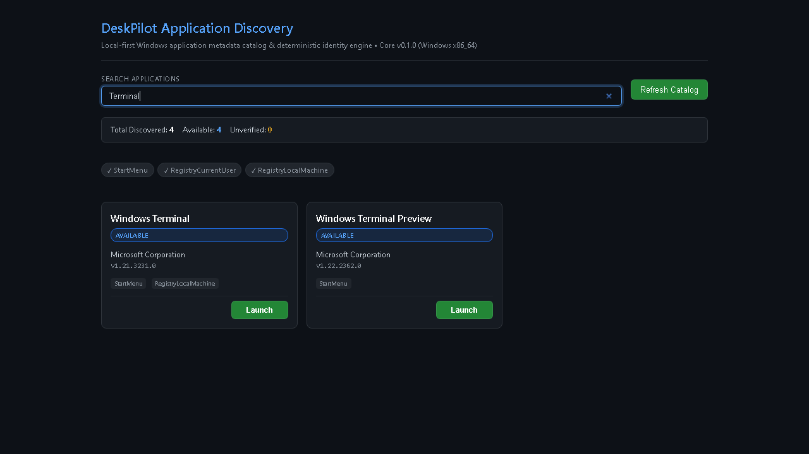

# DeskPilot (v0.1.1 Developer Preview)

<div align="center">

%20Tested%20%7C%20Win%2010%20Pending-0078D6?style=for-the-badge&logo=windows&logoColor=white)


<p align="center">
  <strong>A high-performance, local-first Windows command center built for privacy, determinism, and speed.</strong>
</p>

</div>

---

## Overview

**DeskPilot** is an open-source, technically disciplined command center and launcher engineered natively for Windows. It provides local application indexing, keyboard-first real-time search, native Win32 execution, read-only process monitoring, and system intelligence telemetry. DeskPilot application code contains no implemented outbound network client, analytics, telemetry, or cloud dependencies (see [PRIVACY.md](PRIVACY.md)).

Built on **Tauri 2**, **Rust**, and **React 19**, DeskPilot pairs native Win32 performance with modern UI ergonomics while enforcing defense-in-depth isolation boundaries between the web presentation layer and host operating system privileges.

> [!NOTE]
> **Controlled Developer Preview:** DeskPilot v0.1.1 is an early preview release intended for testing and technical evaluation. Binaries are currently unsigned. On the tested Windows 11 system, native process execution was intercepted by Windows Application Control (Win32 Error 4551), and empirical runtime testing on Windows 10 remains pending. Automated test suites pass 100% (378 passing tests). For comprehensive release and operational details, see [`RELEASE_NOTES_v0.1.1_PREVIEW.md`](RELEASE_NOTES_v0.1.1_PREVIEW.md).

---

## Preview

### Application Discovery Catalog
Discovers applications across Windows Registry hives and Start Menu hierarchies with provenance tracking, operational availability badges, and secure launch controls.


### Real-Time Deterministic Search & Ranking
Real-time query filtering utilizing a four-tier ranking hierarchy (exact match, prefix match, substring match, and publisher metadata) with keyboard-first navigation, query matching, Escape-key clearing, and empty-state rendering.



---

## Core Capabilities

### 🔍 Deterministic Windows Application Discovery
- **Multi-Hive Registry Enumeration:** Exhaustively indexes 64-bit (`KEY_WOW64_64KEY`) and 32-bit (`KEY_WOW64_32KEY`) system software keys across `HKEY_LOCAL_MACHINE` and `HKEY_CURRENT_USER`.
- **Start Menu Hierarchy Scanner:** Traversing both Common (`C:\ProgramData\Microsoft\Windows\Start Menu\Programs`) and Per-User Start Menu directories.
- **128-bit Collision-Resistant Application Identity:** Deterministic SHA-256 identity generation (`app_<32-hex>`) incorporating normalized publishers, application titles, and target paths to eliminate duplicate merge collisions.
- **Availability State Engine:** Continuously tracks target executables and categorizes entries into `Available`, `Unverified`, `IncompleteMetadata`, and `MissingTarget`.

### 🛡️ Memory-Safe MS-SHLLINK Shortcut Parser
- Handcrafted, memory-safe binary parser complying with Microsoft Shell Link specification (`[MS-SHLLINK]`).
- Strict Shell Link Header CLSID verification (`00021401-0000-0000-C000-000000000046`).
- Checked offset arithmetic and bounded file reads (64 KB ceiling) protecting against malicious link-bomb attacks.
- Robust decoding supporting both legacy Windows-1252 ANSI strings and modern UTF-16LE Unicode paths.

### ⚡ Secure Win32 Native Launcher
- **Direct Win32 API Invocation:** Spawns processes directly via Windows `CreateProcessW` without intermediate shell interpreters (`cmd.exe` or `powershell.exe`), eliminating command injection vulnerabilities.
- **Scoped Working Directory Binding:** Resolves working directories directly to target executable parent directories or system roots, scoping the execution context and avoiding reliance on ambient working directories.
- **Target Validation & Established Launch Flow:** Validates application identifiers and launch targets through backend security guards before invocation.
- **Process Isolation:** Detaches launched applications into independent process trees without inheriting privileged handles.
- **Elevation Requirement Handling:** Gracefully handles applications requiring administrator privileges (Win32 Error 740, `ERROR_ELEVATION_REQUIRED`), mapping OS errors to structured permission-denied messages rather than leaking system details or crashing.

### 📊 Native Win32 System Intelligence Monitoring
- **Hardware & CPU Utilization:** Periodic non-blocking retrieval of total processor utilization across system cores via Windows `GetSystemTimes`.
- **Physical Memory Accounting:** Queries system RAM configuration through `GlobalMemoryStatusEx`, presenting total physical capacity, available RAM, and real-time memory pressure.
- **Fixed Storage Partition Telemetry:** Enumerates mounted fixed storage drives using `GetLogicalDriveStringsW` and `GetDiskFreeSpaceExW`, calculating total volume size, free capacity, and percentage used for local partitions while excluding volatile optical or remote network media.
- **Monotonic System & App Uptime:** Tracks host system uptime via `GetTickCount64` and measures continuous DeskPilot application session duration.

### 🧵 Read-Only Process Intelligence & Monitoring
- **Kernel Process Enumeration:** Non-blocking enumeration of active Windows processes via Win32 Toolhelp32 snapshots (`CreateToolhelp32Snapshot`), offloaded to background worker threads.
- **Process Hierarchy & Identification:** Captures process IDs (PIDs), parent PIDs, executable names, and creation timestamps where accessible.
- **Resource Footprint Accounting:** Measures working-set memory footprint and kernel/user CPU times for standard unprivileged processes.
- **Access Limitation & Status Engine:** Gracefully handles protected system processes via query-status categorization (`full`, `partial`, `handleUnavailable`, and `exited`).
- **Read-Only Scope:** Strictly provides process monitoring and enumeration. Process termination, suspension, and killing are deliberately unimplemented in the current release.

### 🔌 Strongly Typed, Least-Privilege IPC Boundary
- **Opaque ID Addressing:** The frontend presentation layer only holds opaque application IDs (`app_<hex>`) and never handles raw filesystem paths, executable arguments, or environment variables.
- **Input Guard Validation:** Rigorous backend validation rejecting malformed identifiers, invalid UTF-8 sequences, and forbidden payload structures.
- **Safe Serialization:** Structured error envelopes ensuring system path leaks do not reach frontend error toasts.

### 🪟 Desktop Lifecycle & System Tray Integration
- **Single-Instance Enforcement:** Automatically detects secondary launches, forwards focus signals, and summons the primary instance without spawning duplicate processes.
- **Native System Tray:** Lives quietly in the Windows notification area with a native context menu (`Show DeskPilot`, `Hide DeskPilot`, `Quit DeskPilot`).
- **Predictable Hide-to-Tray:** Window close events (`X`) gracefully hide the window to the tray while preserving warm state and catalog indices; explicit quit terminates cleanly.
- **Ergonomic Window Constraints:** Configured with a default dimension of 960×680 and strict minimum bounds of 520×450 to guarantee consistent UI layout.

---

## Architecture

```text
┌────────────────────────────────────────────────────────┐
│               Frontend Presentation Layer              │
│               React 19 • TypeScript • Vite             │
│   • ApplicationCatalog        • Search & 4-Tier Rank   │
│   • ApplicationCard           • Keyboard Navigation    │
│   • LaunchButton (Feedback)   • Real-Time Status Badges│
└───────────────────────────┬────────────────────────────┘
                            │
               Typed Tauri 2 IPC Boundary
         (Domain Intents & Opaque Application IDs)
                            │
┌───────────────────────────▼────────────────────────────┐
│                Rust Backend Core (Kernel)              │
│                                                        │
│  ┌───────────────────────┐   ┌──────────────────────┐  │
│  │   Security Kernel     │   │  Application Catalog │  │
│  │ • Input Guard         │   │ • Generational Cache │  │
│  │ • Path Bounds Checker │   │ • RwLock Concurrency │  │
│  └───────────────────────┘   └──────────────────────┘  │
│  ┌───────────────────────┐   ┌──────────────────────┐  │
│  │   Discovery Engine    │   │   System Tray & Win  │  │
│  │ • Registry Scanners   │   │ • Single-Instance    │  │
│  │ • MS-SHLLINK Parser   │   │ • Intercepted Close  │  │
│  └───────────────────────┘   └──────────────────────┘  │
└───────────────────────────┬────────────────────────────┘
                            │ Direct Win32 APIs
┌───────────────────────────▼────────────────────────────┐
│                 Windows Native Platform                │
│       (Win 11 / Win 10 Architecture Compatible)        │
│  • Advapi32 (Registry)       • Shell32 (Shortcuts)     │
│  • Kernel32 (CreateProcessW) • User32 (Tray & Window)  │
└────────────────────────────────────────────────────────┘
```

---

## Security Model & Invariants

DeskPilot is designed around strict defense-in-depth principles:

1. **Least-Privilege Web View & Hardened CSP:** WebView2 operates with restricted permissions. Direct filesystem APIs, shell execution, external URL opener plugins, and Node.js primitives are completely disabled. A strict Content Security Policy (`default-src 'self'; script-src 'self'; style-src 'self' 'unsafe-inline'; img-src 'self'; object-src 'none'; base-uri 'self';`) prevents execution of unapproved scripts or loading of untrusted remote resources.
2. **Path Traversal Guard:** Any filesystem access strictly sanitizes relative segments (`..`, `.\`, `%TEMP%`) and normalizes paths before verification.
3. **No Shell Intermediate:** Launch commands are never formatted as string shell scripts. Process creation bypasses shell parsing entirely.
4. **Local Data Sovereignty:** The audited DeskPilot application code contains no implemented outbound HTTP or WebSocket client, analytics, telemetry, or automatic update mechanism. DeskPilot's core functionality does not require an active internet connection after installation. The embedded installer includes the official Microsoft Edge WebView2 bootstrapper; if the WebView2 runtime is already present on the host system (standard on Windows 11 and modern updated Windows 10), installation proceeds entirely offline. Active internet access is required during installation only if the host machine lacks the WebView2 runtime. (Note: The embedded Microsoft WebView2 runtime, host Windows components, installers, and applications launched by the user operate under their own system runtime policies; see [`PRIVACY.md`](PRIVACY.md)).

> [!NOTE]
> **Scope of Security & Networking Observations:**  
> DeskPilot's security model represents defense-in-depth architectural design, input validation guards, and short-duration interactive testing; it has **not undergone third-party penetration testing or binary exploit analysis**. Furthermore, while empirical testing observed zero active TCP/UDP sockets during short-duration sessions, this does not establish that network activity from external runtime components (such as WebView2 background services) is impossible across all host configurations.

---

## Windows Security, Code Signing & Application Control Disclosures

DeskPilot v0.1.1 release binaries are currently **unsigned** (`Get-AuthenticodeSignature` reports `NotSigned`):

- **Unsigned Publisher Status:** An Authenticode certificate is not strictly necessary to run or evaluate an open-source preview in an unconstrained environment, but unsigned binaries encounter Windows security prompts and Application Control enforcement.
- **Microsoft Defender SmartScreen:** When downloading or launching the unsigned installer or standalone executable, Windows Defender SmartScreen may display an *"Unknown Publisher"* warning (*"Windows protected your PC"*). SmartScreen calculates reputation algorithmically based on download telemetry; even when an Authenticode certificate is attached, warning-free execution is not guaranteed immediately until reputation accrues over time.
- **Windows Application Control & Error 4551:** Windows Application Control blocked execution of the unsigned application on the tested Windows 11 machine (Win32 Error `4551` / `0x11C7`, Code Integrity Operational Events `3033` and `3077` under Policy ID `{0283ac0f-fff1-49ae-ada1-8a933130cad6}`). Application behavior depends entirely on the host machine's active security policy (such as Smart App Control or App Control for Business / WDAC). Applying an Authenticode certificate establishes eligibility for trust evaluation, but code signing alone does not guarantee that every Application Control restriction will be automatically bypassed if the active policy restricts execution to specific organizational roots or whitelisted publishers.
- **Benefits of Authenticode Signing:** Authenticode digital signing provides cryptographic tamper resistance, verifies publisher identity, and serves as an anchor for building reputation across releases.
- **Security Guidance:** Never disable Microsoft Defender SmartScreen, Smart App Control, or Windows Application Control policies to bypass security warnings. If your security policies require digitally signed binaries, please defer evaluating DeskPilot until officially signed releases become available.

---

## Installer Lifecycle, Downgrade Limitation & Retained Data

- **Windows Installer Package:** The provided MSI installer (`deskpilot_0.1.1_x64_en-US.msi`) configures a per-machine installation target (`C:\Program Files\deskpilot`), requiring administrative elevation during installation. Shortcuts are cleanly registered in the Start Menu (`ApplicationProgramsFolder`), Desktop (`CommonDesktopFolder`), and an uninstallation shortcut is placed in the application's Start Menu program group.
  - *Verified Successful Transitions (Sandbox):* Silent fresh installation (`msiexec /i`), major upgrade from v0.1.0 to v0.1.1 (clean binary replacement, single ARP registration, and user data survival), maintenance repair (`msiexec /fa`), and clean uninstallation (`msiexec /x`).
  - *Known Limitation (Legacy Downgrade Ingress):* While DeskPilot v0.1.1 contains internal downgrade detection guards (`WIX_DOWNGRADE_DETECTED`), the legacy v0.1.0 installer predates commit `9169fcf` and lacks downgrade detection guards. When tested, executing the legacy v0.1.0 MSI over an existing v0.1.1 installation resulted in an unguarded downgrade back to v0.1.0. **Do not run the older v0.1.0 MSI over an existing v0.1.1 installation.** (Note: Only these specific lifecycle transitions were evaluated in isolated sandbox environments; clean-machine installation lifecycle validation on dedicated production systems remains pending).
- **Uninstallation & Retained Profile Data:** The uninstallation test (`msiexec /x`) demonstrated clean removal of application binaries (`C:\Program Files\deskpilot`), Start Menu and Desktop shortcuts, and the Add/Remove Programs registry entry. However, the test also demonstrated that user profile and runtime data created by the embedded WebView2 runtime remained on disk under:
  ```text
  %LOCALAPPDATA%\com.deskpilot.app\EBWebView
  ```
  In the tested sandbox environment, this retained directory contained 192 files totaling approximately 7.93 MB; these values are test-environment measurements and will vary based on user activity. The installer package does not automatically purge this directory during uninstallation; complete removal requires manually deleting it.

---

## Release Checksums (v0.1.1)

Verify release binaries against their official SHA-256 cryptographic digests (verified from GitHub Actions CI run `43748999208`, source commit `3a597f07c57e2e88b3d0950a176626a096b3f2f0`):

| Artifact | File Name | Format | Size (Bytes) | SHA-256 Cryptographic Checksum |
| :--- | :--- | :---: | :---: | :--- |
| **MSI Installer** | `deskpilot_0.1.1_x64_en-US.msi` | WiX MSI | 4,149,248 | `6a7f998493239adb9a2cd0e945df536ec3adf15b6197ecfeefe4668897fc66c4` |
| **Standalone Executable** | `deskpilot.exe` | Win32 PE | 4,613,632 | `cde1573adea1899a2f74f4334eaf7fc3a702a2bcff4b31db3a23434998d35541` |

> [!NOTE]
> **Controlled Artifact Availability:**
> The release artifacts above were generated and validated in hosted GitHub Actions CI run `43748999208` from commit `3a597f0`. Git tag and GitHub draft release asset synchronization are governed by controlled development gates; the artifacts are not yet published for general public download.

---

## Development & Build

### Prerequisites

| Component | Minimum Version | Recommended |
|---|---|---|
| **OS** | Windows 11 x64 (Runtime-Tested) | Windows 10 x64 (Pending Runtime Verification) |
| **Node.js** | Node.js v20+ | Node.js v22+ LTS |
| **Rust** | Rust 1.80+ | Rust MSVC Toolchain (`x86_64-pc-windows-msvc`) |
| **C++ Build Tools** | Visual Studio Build Tools 2022 | MSVC v143 / Windows 10/11 SDK |
| **WebView2** | Evergreen Runtime | Pre-installed on Windows 10/11 |

### Setup & Commands

All commands can be run via PowerShell or Command Prompt. Use `npm.cmd` on Windows if PowerShell execution policies restrict script execution:

```powershell
# Clone the repository
git clone https://github.com/youssefmanssouri/deskpilot-.git
cd deskpilot-

# Install frontend dependencies
npm.cmd install

# Type-check TypeScript and build the production web bundle
npm.cmd run build

# Run frontend test suite (170 tests across 13 suites)
npm.cmd test -- --run

# Launch full desktop application in development mode (with hot reload)
npm.cmd run tauri dev
```

---

## Automated Verification Suite

DeskPilot maintains a total of **378 automated tests executed and passing** across both frontend presentation and native backend layers:

- **Frontend Test Suite Execution Evidence:** **170 tests passed** (`npm test -- --run`), executed across 13 Vitest suites.
- **Backend Test Suite Execution Evidence:** **208 tests passed** (`cargo test --locked`), executed across unit and integration test suites in hosted CI run `43748999208` (144 unit tests in `src/lib.rs` including elevation handling test `test_spawn_error_elevation_required`, 14 in `tests/cli.rs`, 38 in `tests/core.rs`, 12 in `tests/security.rs`). Local execution on developer hosts may be blocked if Windows Application Control intercepts unsigned cargo test build-scripts.
- **TypeScript Compilation:** Zero compilation errors (`tsc --noEmit`).
- **Testing Boundary Distinction:** These automated test suites execute in headless environments (Node.js/JSDOM for Vitest; console test harness for Cargo). They empirically validate logical correctness, state transitions, binary parsing, and IPC contracts; they do **not** constitute native GUI surface verification, live WebView2 window rendering, or runtime acceptance by host security policies.
- **Consolidated Release Verification Matrix (Phase 12.6.5):**
  - **Automated Tests:** 378 passing tests (170 frontend + 208 backend).
  - **Installer Architecture:** Per-machine WiX MSI packaging verified with 0 ICE errors in CI.
  - **1 documented known limitation:** legacy v0.1.0 downgrade ingress.
  - **1 blocked criterion:** native Windows 11 runtime execution (blocked by Windows Application Control with Error 4551 on enforced hosts).
  - **1 pending verification:** empirical runtime verification on genuine Windows 10 hardware/VMs.
  - **1 pending verification:** clean-machine installation lifecycle validation on dedicated Windows 11 hardware.
  - **1 unsatisfied gate:** Authenticode digital signing for unrestricted general distribution.
  - **Non-functional UI placeholders:** Settings, Terminal, and Window Layout controls in the navigation sidebar are non-functional UI placeholders in this preview.

### Frontend Test Breakdown (Vitest — 170 Passing Across 13 Suites)
- `SystemMonitor.test.tsx` (27 tests): CPU gauge rendering, memory pressure indicators, storage partition cards, uptime formatting, and refresh timers.
- `ApplicationCatalog.test.tsx` (26 tests): Discovery loading, error states, keyboard navigation, empty state handling, and refresh lifecycles.
- `ProcessMonitor.test.tsx` (24 tests): Read-only process list rendering, column sorting, CPU/memory formatting, truncation banner, stale response protection, and error recovery.
- `interaction.test.tsx` (31 tests): Component interaction, keyboard-first arrow navigation, quick-select, focus traps, and modal controls.
- `LaunchButton.test.tsx` (12 tests): Launch invocation, pending state, success confirmation reset, error recovery, and timer unmount hygiene.
- `ApplicationInspector.test.tsx` (8 tests): Detailed metadata inspection, target path display, publisher provenance, and launch delegation.
- `ProcessInspector.test.tsx` (7 tests): Process detail modal, PID and memory accounting, query-status badges, and read-only invariants.
- `discovery.test.ts` (8 tests): Typed IPC contract validation for application discovery and payload integrity.
- `processes.test.ts` (7 tests): Process enumeration, snapshot IPC contracts, status enum validation, and typed error deserialization.
- `launcher.test.ts` (6 tests): Launch IPC contract validation and error mapping.
- `ApplicationCard.test.tsx` (6 tests): Card rendering, availability badge states, publisher provenance display.
- `system.test.ts` (4 tests): Typed IPC contracts for system times, memory metrics, and drive partitions.
- `ipc.test.ts` (4 tests): Typed error serialization and boundary protection.

### Backend Test Breakdown (Cargo / Rust — 208 Passing)
- **Unit Tests (`src/lib.rs`):** **144 tests passed** covering application discovery and registry scanning, application identity hashing, safe process launching and path traversal checks, process service and provider integration, system intelligence metrics (CPU, RAM, fixed disks, uptime), in-memory `AppState` concurrency, system tray lifecycle, error sanitization, and input guard validation.
- **CLI Integration Suite (`tests/cli.rs`):** **14 tests passed** validating command-line flags, version output, and argument validation.
- **Core Integration Suite (`tests/core.rs`):** **38 tests passed** covering end-to-end catalog indexing, state transition, and launch validation.
- **Security Integration Suite (`tests/security.rs`):** **12 tests passed** validating bounds checking, path traversal rejection, and process privilege detachment.

---

## Project Roadmap

- [x] **Phase 1:** Architectural Foundation & Security Baseline
- [x] **Phase 2:** Hardened Discovery Engine & Registry Scanner
- [x] **Phase 3:** MS-SHLLINK Binary Parser & Application Identity
- [x] **Phase 4:** Win32 Secure Launcher, Typed IPC & Catalog Integration
- [x] **Phase 5.1:** Window Lifecycle Hardening, Single-Instance & 4-Tier Search Ranking
- [x] **Phase 5.2:** Native System Tray & Summon Integration
- [ ] **Phase 6:** Safe Local File Operations (Recycle Bin Integration & Rollback Ledgers)
- [ ] **Phase 7:** SQLite Persistence & Operation Audit Trail
- [ ] **Phase 8:** System Resource Monitoring & Health Metrics

---

## Documentation & Privacy

- **Release Notes & Preview Disclosures:** Comprehensive preview details, security notices, checksums, and installer guidance are documented in [`RELEASE_NOTES_v0.1.1_PREVIEW.md`](RELEASE_NOTES_v0.1.1_PREVIEW.md).
- **Privacy Architecture:** Technical details regarding local data sovereignty, in-memory state, and host platform boundaries are documented in [`PRIVACY.md`](PRIVACY.md).

---

## License

This project is licensed under the [MIT License](LICENSE).
