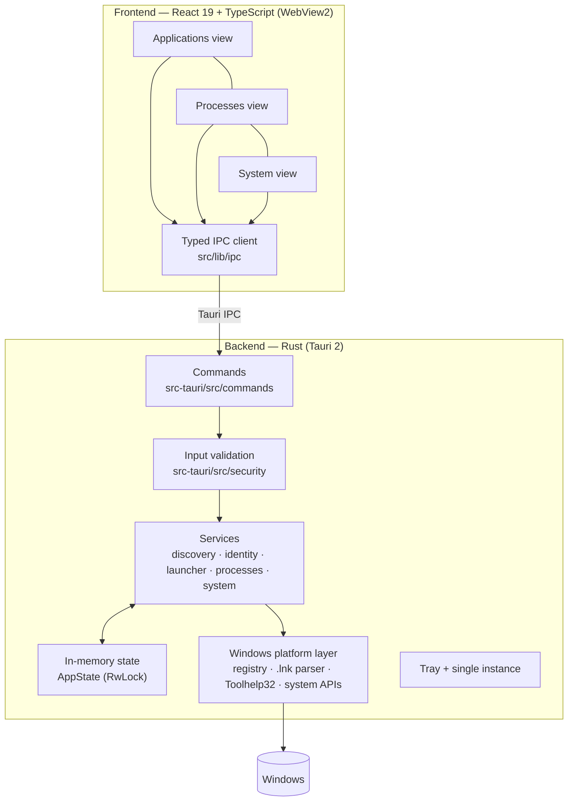

<p align="center">
  
</p>

<h1 align="center">DeskPilot</h1>

<p align="center">
  <strong>A local-first Windows desktop command center: find and launch installed applications, inspect running processes, and monitor system resources — without accounts, cloud services, or telemetry.</strong>
</p>

<p align="center">
  
  
  
</p>

> [!IMPORTANT]
> **v0.1.1 is a developer preview release.** Release binaries are **unsigned**, are distributed publicly on GitHub for technical evaluation and developer testing on Windows 11, and have **not been validated on physical Windows 10 hardware**. To evaluate DeskPilot, verify preview packages against the documented checksums or [build from source](#building-from-source). See [Known limitations](#known-limitations) before use.

---

## Contents

- [Status at a glance](#status-at-a-glance)
- [Features](#features)
- [What DeskPilot does not do](#what-deskpilot-does-not-do)
- [System requirements](#system-requirements)
- [Installation](#installation)
- [Privacy and network behavior](#privacy-and-network-behavior)
- [Security model](#security-model)
- [Architecture](#architecture)
- [Testing and validation](#testing-and-validation)
- [Building from source](#building-from-source)
- [Known limitations](#known-limitations)
- [Roadmap](#roadmap)
- [Contributing](#contributing)

---

## Status at a glance

| Area | Status |
| :--- | :--- |
| Version | `0.1.1` developer preview release (commit `e99ccb8`) |
| Code signing | Not signed. No commercial certificate enrolled. |
| Public download | Available as a Developer Preview release asset on GitHub Releases. |
| Windows 11 x64 | **Physical desktop runtime acceptance validated** on Windows 11 Pro 25H2 (Phase 16.38). In-place elevated MSI upgrade, installed binary startup, WebView2 Evergreen runtime initialization, Quick Launcher (`Ctrl+Alt+Space`), application discovery (138 apps), safe Win32 launching, read-only Process Monitor (1,784 process entries), System Intelligence (1-to-1 host metric parity), system tray with hide-to-tray, single-instance mutex, and 86+ minute sustained soak observation passed 100%. (In isolated Windows Sandbox container testing, execution was previously blocked by container hypervisor WDAC policy `VerifiedAndReputableDesktop`). |
| Windows 10 x64 | **Not tested on physical hardware.** Architecture and Win32 APIs are compatible; empirical validation pending. |
| Windows on ARM64 | Not built, not tested. |
| Clean-machine install lifecycle | In-place elevated MSI upgrade, public shortcut placement (`%PUBLIC%\Desktop` and `%PROGRAMDATA%\...`), and clean user data preservation validated on physical Windows 11 host. Windows 10 physical validation remains outstanding. |
| Automated tests | 244 frontend + 205 backend test cases defined; both suites gate the release build in CI. See [Testing and validation](#testing-and-validation). |

---

## Features

DeskPilot combines a modern, monochrome command center with low-level Windows integration across four primary interfaces: **Home**, **Applications**, **Processes**, and **System Intelligence**, supplemented by a global **Quick Launcher** and **System Tray** presence.

### Home: overview and quick actions
- **PC Summary:** Host system health, active Windows build, and real-time CPU and memory telemetry sparklines.
- **Recent Apps:** Shows recently launched applications with direct one-click or keyboard relaunching (stored locally in `launch-history.json`, disabled or cleared anytime).
- **Needs Attention:** Proactive status flags for unverified targets or partial catalog read warnings.

### Applications: discovery, search, and safe launch
- **Discovery Sources:** Reads installed-application metadata from:
  - `HKLM\Software\Microsoft\Windows\CurrentVersion\Uninstall` (64-bit view)
  - `HKLM\Software\Wow6432Node\Microsoft\Windows\CurrentVersion\Uninstall` (32-bit view)
  - `HKCU\Software\Microsoft\Windows\CurrentVersion\Uninstall`
  - Common Start Menu (`%ProgramData%\Microsoft\Windows\Start Menu\Programs`) and per-user Start Menu (`%APPDATA%\Microsoft\Windows\Start Menu\Programs`) `.lnk` shortcuts
- **Memory-Safe Shortcut Parsing:** `.lnk` files are parsed by a bounded binary parser (64 KiB read limit, Shell Link CLSID check, UTF-16LE and ANSI path support). No COM or shell handlers are invoked, and nothing is executed during discovery.
- **Deduplication with Stable IDs:** Entries found across multiple sources are merged under a deterministic `app_<32 hex>` identifier (first 128 bits of SHA-256 over normalized publisher, name, and executable metadata).
- **Availability States:** Each entry is classified as `Available`, `Unverified`, `IncompleteMetadata`, or `MissingTarget`. Overlapping scans are prevented.
- **Real Application Icons:** Reads native 64×64 32bpp RGBA icons directly from `.exe` resources via Win32 Shell APIs (`SHDefExtractIconW`), rendered via HTML5 canvas. Packaged Windows Store app execution aliases gracefully display clean two-letter monogram fallback badges.
- **Search & Filter:** Instant keyboard-first filtering ranked in four tiers (exact name → prefix → substring → publisher). `Ctrl+K` focuses search, arrow keys move selection, `Enter` launches, `Esc` clears.
- **Safe Launching:** Target must be an existing local `.exe` (UNC, device, and temp/Downloads paths rejected); started directly with Rust's `std::process::Command` without shell interpretation.

### Quick Launcher (`Ctrl+Alt+Space`)
- Borderless, centered floating palette accessible globally from any Windows application via customizable hotkey (`Ctrl+Alt+Space`).
- Win32 `SetForegroundWindow` activation and 400ms dismissal grace period to ignore transient creation blur events.
- Type to search apps, arrow keys to navigate, `Enter` to launch, `Ctrl+Enter` to inspect in DeskPilot, `Esc` to clear query or close.

### Processes: strictly read-only monitor
- Enumerates running processes with a Toolhelp32 snapshot on a dedicated background worker pool.
- Shows PID, parent PID, name, executable path, start time, working-set memory, session ID, and cumulative CPU time.
- Queries each process with `PROCESS_QUERY_LIMITED_INFORMATION` only.
- **Strictly read-only:** DeskPilot cannot end, suspend, or modify processes; zero process termination or modification code exists in the application.

### System Intelligence
- **CPU:** System-wide utilization calculated from successive `GetSystemTimes` samples.
- **Memory:** Physical RAM total, available, and in-use (`GlobalMemoryStatusEx`).
- **Storage:** Fixed drives only (`GetDriveTypeW` = fixed; optical and network shares excluded).
- **Uptime:** Monotonic system uptime (`GetTickCount64`) and session duration.
- Configurable refresh interval: manual, 3 s, or 5 s.

### Settings & Local Preferences
- Monochrome UI theme selection: Light, Dark, or System matching.
- Quick Launcher global shortcut configuration.
- Optional "Start with Windows" per-user startup entry (`HKCU\...\Run`).
- Recent apps history toggle (clearing history deletes `launch-history.json`).
- Windows 11 Mica glass effect toggle (`supports_glass` guards against non-Windows 11 hosts).

### Desktop Integration
- **Single Instance:** Second launch forwards focus to the existing window via `tauri-plugin-single-instance`.
- **System Tray:** Notification area menu with *Show DeskPilot*, *Hide DeskPilot*, and *Quit DeskPilot*. Closing the window hides to tray.
- Window bounds: default 960×680, minimum 520×450.

---

## What DeskPilot does not do

To set accurate expectations for this preview:

- **No process termination**, suspension, or priority changes. DeskPilot is strictly a monitor, not a task killer.
- **No cloud accounts, sync, or telemetry** — all state is local; settings and launch history live in `%LOCALAPPDATA%\com.deskpilot.app` (`settings.json` and `history.json`) and can be disabled or deleted anytime.
- **No Microsoft Store manifest parsing** — packaged execution aliases display clean two-letter monogram cards rather than extracting Appx manifests.
- **No launch arguments**, no "run as administrator", no launching from Downloads or temp folders.
- **No auto-update mechanism.**
- **No ARM64 build.**

---

## System requirements

| Requirement | Details |
| :--- | :--- |
| Operating system | Windows 11 x64. Windows 10 x64 is expected to work but is **untested**. |
| WebView2 Runtime | Microsoft Edge WebView2 (Evergreen). Included with Windows 11; often, but not always, present on Windows 10. The installer adds it if missing — see below. |
| Install permissions | Administrator rights (the MSI installs per-machine). |
| Security policy | Your system must permit running **unsigned** software. Hosts enforcing Smart App Control or App Control for Business may block DeskPilot. |

---

## Installation

> [!NOTE]
> DeskPilot v0.1.1 is distributed as a Developer Preview release on GitHub Releases. This section documents the behavior of the v0.1.1 MSI for evaluators and for anyone building the installer from source.

### Installer behavior

- **Package:** `deskpilot_0.1.1_x64_en-US.msi` (WiX v3.14), per-machine install (`ALLUSERS=1`) to `C:\Program Files\deskpilot`.
- **Creates:** Public desktop shortcut (`%PUBLIC%\Desktop\DeskPilot.lnk`), Common Start Menu shortcut (`%ProgramData%\Microsoft\Windows\Start Menu\Programs\DeskPilot\DeskPilot.lnk`), an uninstall shortcut in the Start Menu folder, and one *Installed apps* entry. Erroneous legacy paths (`C:\Desktop`, `C:\deskpilot`) are completely eliminated.
- **Tested (Physical Windows 11 Host, Phase 16.38 & Sandbox Container, Phase 16.29):** Elevated in-place major upgrade (`msiexec /i …`), public shortcut creation, single ARP registration, installed executable execution, and clean user data preservation verified on Windows 11 Pro 25H2. (In earlier Windows Sandbox testing, installer lifecycle passed but container hypervisor WDAC policy blocked binary execution).

### WebView2 runtime

The MSI embeds Microsoft's WebView2 **bootstrapper** (not the full runtime) and runs it silently during setup:

- If the WebView2 Runtime is already installed, setup completes **without network access**.
- If it is missing, the bootstrapper **downloads the runtime from Microsoft** — an internet connection is required in that case.

### Unsigned binaries, SmartScreen, and Application Control

`Get-AuthenticodeSignature` reports `NotSigned` for v0.1.1 binaries. As a result:

- **SmartScreen** may show *"Windows protected your PC"* / *Unknown publisher*.
- **Windows Defender Application Control (WDAC) / Smart App Control** may block DeskPilot outright without an inline override prompt when signed-binary whitelisting is enforced. While the installed binary executed successfully on the physical developer host where UMCI was not enforced (Phase 16.38), execution of the unsigned installed binary inside Windows 11 Enterprise Sandbox was blocked by container WDAC policy `{0283ac0f-fff1-49ae-ada1-8a933130cad6}` (`VerifiedAndReputableDesktop`, Code Integrity Event IDs 3077/3089/3099, Win32 error 4551).
- Digital code signing with an Authenticode certificate would establish publisher identity, but environments enforcing strict App Control policies may still require explicit policy authorization.

**Do not disable SmartScreen, Smart App Control, or organizational App Control policies to run DeskPilot.** If your policy requires signed software, wait for a signed release or evaluate from source in an environment where that is permitted.

### Verifying a download

Obtain binaries only from this repository. Verify the SHA-256 before running:

```powershell
Get-FileHash -Algorithm SHA256 .\deskpilot_0.1.1_x64_en-US.msi
```

| File | Size (bytes) | SHA-256 |
| :--- | ---: | :--- |
| `deskpilot_0.1.1_x64_en-US.msi` | 4,538,368 | `7EF4CBBC6EBCB759406067CE4108D617B0857E84EA07498C488B56BB7FD90CFD` |
| `deskpilot.exe` (standalone release binary) | 5,162,496 | `6BC7A9288456FA50144571F0167156ED01638264492B5AC3A9CE90D547AB2CA0` |
| `deskpilot.exe` (extracted MSI payload) | 5,162,496 | `4C3DD390D1B13693EC613F14D447A003D3587114D338E7C47AA24D5092166D4C` |

Digests reflect the verified preview release compiled from commit `e99ccb84b1883a6a844e6576f2141a62ee74518f` (`e99ccb8`). (Note: The NSIS installer format was deprecated and discontinued in Phase 16.26; the preview release is strictly MSI-only). The `deskpilot.exe` installed by the MSI has a distinct hash from the standalone binary because the Tauri CLI bundler stamps a 3-byte package-type marker (`__TAURI_BUNDLE_TYPE_VAR_MSI` vs `__TAURI_BUNDLE_TYPE_VAR_UNK` at byte offset 4,864,919) into the MSI copy; executable logic and machine instructions are 100% byte-for-byte identical. Full details are in the [release notes](RELEASE_NOTES_v0.1.1_PREVIEW.md).

### Upgrading and downgrading

- Installing v0.1.1 over an existing installation performs a standard Windows Installer major upgrade (verified in Phase 16.38).
- The v0.1.1 installer includes a downgrade guard, but **the older v0.1.0 MSI does not. Do not run the v0.1.0 MSI over v0.1.1** — in testing it downgraded the installation without warning.

### Uninstalling

Uninstall from **Settings → Apps → Installed apps**, or:

```powershell
msiexec /x deskpilot_0.1.1_x64_en-US.msi
```

This removes the program files, shortcuts, and the *Installed apps* entry. **WebView2 profile data is left behind** at `%LOCALAPPDATA%\com.deskpilot.app\EBWebView` (about 8 MB / 192 files in historical Phase 10.9C testing). Delete that folder manually for a complete removal.

---

## Privacy and network behavior

**DeskPilot's own code** (Rust backend and React frontend):

- implements no HTTP/WebSocket client, analytics, telemetry, crash reporting, or update check;
- writes no external database, remote telemetry, or disk-based logs. Local state is confined strictly to two local files (`settings.json` and `launch-history.json`) in `%LOCALAPPDATA%\com.deskpilot.app\` and, only if explicitly enabled, one per-user startup entry (see [PRIVACY.md](PRIVACY.md));
- serves its UI from assets embedded in the executable, under a Content Security Policy that only allows same-origin resources.

**Components DeskPilot depends on behave independently:**

- **WebView2 Runtime** is a Microsoft component that is updated and managed by Windows/Edge and may make its own network connections under Microsoft's policies. It also stores profile data in `%LOCALAPPDATA%\com.deskpilot.app\EBWebView`.
- **The installer** may download the WebView2 Runtime if it is absent (see [Installation](#webview2-runtime)).
- **Applications you launch** run as independent processes with their own network and data behavior.

Short interactive test sessions observed no open TCP/UDP sockets from DeskPilot. That is an observation, not a guarantee about WebView2 or Windows behavior across all configurations. See [PRIVACY.md](PRIVACY.md) for details.

---

## Security model

The web UI is treated as untrusted; the Rust backend decides what is allowed.

| Control | Implementation |
| :--- | :--- |
| Minimal IPC surface | 20 typed commands: app status, intent validation, elevation check, discover applications, launch application, get application icon, get/clear launch history, list applications, hide launcher, show main window, get/set launcher shortcut, get/set settings (theme, history enabled, start with Windows, glass effect), list processes, get system metrics. |
| Minimal WebView permissions | Tauri capability set is `core:default` only — no filesystem, shell, or opener plugins. |
| Content Security Policy | `default-src 'self'; script-src 'self'; style-src 'self' 'unsafe-inline'; img-src 'self'; object-src 'none'; base-uri 'self';` |
| Opaque application IDs | The UI receives application IDs, names, publishers, versions, sources, and availability — not executable paths. Launch requests carry only an ID, validated as `app_` + 32 lowercase hex characters. |
| No shell execution | Processes are created directly without `cmd.exe`/PowerShell and without arguments. |
| Launch-target validation | See [Launching](#applications-discovery-and-launch): local `.exe` only, canonicalized, temp/Downloads refused, re-checked at launch. |
| Least-privilege process queries | `PROCESS_QUERY_LIMITED_INFORMATION` only; no write or terminate access is requested. |
| Error sanitization | Backend errors are mapped to structured codes with messages stripped of filesystem paths and OS internals. |

**Scope of assurance:** these controls are backed by code review, unit/integration tests, and short sandboxed sessions (roughly 4–11 minutes). DeskPilot has **not** had a third-party penetration test, binary exploit analysis, or long-duration stability testing (multi-day runs, sleep/resume, memory pressure).

---

## Architecture



### Technology stack

| Layer | Technology |
| :--- | :--- |
| Desktop shell | Tauri 2 (WebView2 on Windows) |
| Backend | Rust (edition 2024), `windows-sys`, `winreg`, `sha2`, `serde` |
| Frontend | React 19, TypeScript 6, Vite 8 |
| Tests | Vitest + Testing Library + jsdom; Rust built-in test harness |
| Installer | WiX Toolset 3.14 (MSI) with embedded WebView2 bootstrapper |
| CI | GitHub Actions, `windows-2022`, manually dispatched release workflow |

More detail: [docs/ARCHITECTURE.md](docs/ARCHITECTURE.md).

---

## Testing and validation

DeskPilot distinguishes **automated tests** (logic verified without a real desktop) from **runtime validation** (the actual app running on Windows). Passing automated tests do not imply the GUI was exercised.

### Automated tests

| Suite | Runner | Test cases defined | Where |
| :--- | :--- | ---: | :--- |
| Frontend components, launcher, and IPC contracts | Vitest (jsdom) | 244 in 14 files | `src/components/__tests__`, `src/launcher/__tests__`, `src/lib/ipc/__tests__` |
| Backend unit tests | `cargo test` | 166 | `#[cfg(test)]` modules in `src-tauri/src` |
| Backend integration tests | `cargo test` | 39 in 3 files | `src-tauri/tests` |

The release workflow ([`build-release.yml`](.github/workflows/build-release.yml)) runs `npm test` and `cargo test --locked` as gates before building the MSI; any failure stops the build. The workflow runs on manual dispatch only — it is not triggered by pushes or pull requests.

These suites run headless (jsdom for the UI; the Rust harness for the backend). They verify logic, parsing, validation, state handling, and IPC contracts. They do **not** render the real WebView2 window, exercise the installer, or test behavior under Windows security policies.

### Runtime validation

| Scenario | Result |
| :--- | :--- |
| Windows 11 physical desktop: elevated MSI upgrade, installed binary execution, and full 15-point functional acceptance (Phase 16.38) | ✅ Passed (Phase 16.38) |
| Windows 11 physical desktop: Quick Launcher 5-cycle activation (`Ctrl+Alt+Space`), 400ms dismissal grace period, native 64×64 icon extraction | ✅ Passed (Phase 16.21 & 16.38) |
| Windows 11 physical desktop: live application discovery (138 apps), search filtering, and safe launch execution (`About Java` -> `javaw.exe`) | ✅ Passed (Phase 16.38) |
| Windows 11 physical desktop: read-only Process Monitor (1,784 entries) and System Intelligence (exact host CIM metric parity) | ✅ Passed (Phase 16.38) |
| Windows 11 physical desktop: system tray lifecycle, hide-to-tray on close, single-instance mutex, and 86+ minute sustained soak observation | ✅ Passed (Phase 16.38) |
| Windows 11, Windows Sandbox: silent MSI install → public desktop shortcut (`%PUBLIC%\Desktop`) → Common Start Menu shortcut (`%PROGRAMDATA%\...`) → clean uninstall | ✅ Passed (Phase 16.29) |
| Windows 11, Windows Sandbox: secondary standard user provisioning (`TestUser2`) with public shortcut visibility | ✅ Passed (Phase 16.29) |
| Windows 11, Windows Sandbox: runtime execution of unsigned installed binary | ❌ Blocked by container WDAC policy `{0283ac0f...}` (Phase 16.29, Event 3077) |
| Windows 11, Windows Sandbox: upgrade from v0.1.0, repair, uninstall | ✅ Evaluated in Phase 10.9C / Phase 16.29 |
| Windows 11, Windows Sandbox: interactive (non-silent) installer wizard | ⚠️ Not tested |
| Second-user interactive GUI login and application launch | ⏳ Pending (Windows Sandbox supports single session only) |
| Windows 10 (physical or VM) | ⏳ Pending (untested on physical Windows 10 hardware) |

Physical host validation (Phase 16.38) demonstrated complete end-to-end functionality for the installed application on Windows 11 Pro 25H2 across an 86+ minute soak (~29.4 MB working set, zero runaway heap growth observed). In isolated Windows Sandbox container testing (Phase 16.29), installer lifecycle and shortcut directory layout were verified with zero ICE errors, while hypervisor-enforced container WDAC policies halted unsigned execution. Physical Windows 10 validation remains outstanding. Full details are in the [release notes](RELEASE_NOTES_v0.1.1_PREVIEW.md).

---

## Building from source

### Prerequisites

| Tool | Version |
| :--- | :--- |
| Windows | 10 or 11, x64 |
| Node.js / npm | CI uses Node **24.15.0** / npm **11.12.1** |
| Rust | MSVC toolchain `x86_64-pc-windows-msvc`. Edition 2024 requires **1.85 or newer**; CI uses **1.99.1**. |
| C++ build tools | Visual Studio 2022 Build Tools with MSVC v143 and a Windows 10/11 SDK |
| WebView2 Runtime | Required to run the app |
| WiX Toolset 3.14 | Only to build the MSI (`tauri build`) |

### Commands

On systems where PowerShell's execution policy blocks `npm`, use `npm.cmd` instead.

```powershell
git clone https://github.com/youssefmanssouri/deskpilot-.git
cd deskpilot-
npm ci
```

```powershell
# Run the desktop app in development mode (hot reload)
npm run tauri dev
```

```powershell
# Frontend tests
npm test
```

```powershell
# Backend tests
cargo test --locked --manifest-path src-tauri/Cargo.toml
```

```powershell
# Type-check and build the web bundle
npm run build
```

```powershell
# Build the release executable and MSI
npm run tauri -- build --bundles msi
```

> [!NOTE]
> On machines enforcing Smart App Control or App Control for Business, locally compiled, unsigned build-script executables may be blocked, causing `cargo test` or `tauri dev` to fail. The CI workflow is the reference environment for backend tests.

### Project structure

```text
src/                     React frontend
  components/            Views, inspectors, hooks (+ __tests__)
  lib/ipc/               Typed IPC client and error types (+ __tests__)
src-tauri/
  src/commands/          IPC command handlers
  src/core/              Discovery, identity, launcher, process and system services
  src/platform/windows/  Registry, .lnk, Toolhelp32 and system API access
  src/security/          Input validation
  src/state/             In-memory application state
  src/tray/              System tray
  tests/                 Rust integration tests
  wix/main.wxs           MSI template
docs/                    Architecture notes and screenshots
```

---

## Known limitations

- **Unsigned binaries** — expect SmartScreen warnings; App Control policies may block execution.
- **Windows 10 untested on physical hardware**; Windows 11 installed-runtime validated in Phase 16.38 (Windows Sandbox container previously blocked execution via container WDAC).
- **Third-party app launching** from the catalog was verified on physical host (`About Java` in Phase 16.38), but was blocked in Windows Sandbox by container WDAC.
- **v0.1.0 → downgrade risk** — do not run the v0.1.0 MSI over v0.1.1.
- **Leftover WebView2 data** after uninstall in `%LOCALAPPDATA%\com.deskpilot.app\EBWebView`.
- **Store/MSIX apps not discovered.**
- **Availability is a scan-time snapshot**; use **Refresh** after installing or removing software.
- **Process CPU column shows cumulative CPU time**, not current CPU usage.
- **No third-party security audit** and no long-duration stability testing.

---

## Roadmap

Planned, **not implemented**:

- Safe local file operations (Recycle Bin–based deletes with rollback)
- Optional local persistence (SQLite) and an operation audit trail
- Authenticode code signing
- Windows 10 and clean-machine validation

No dates are committed.

---

## Contributing

Bug reports and pull requests are welcome via [GitHub Issues](https://github.com/youssefmanssouri/deskpilot-/issues).

- For bugs, include your Windows version and build, whether WebView2 was preinstalled, and any App Control/SmartScreen messages.
- Before opening a pull request, run `npm test`, `cargo test --locked --manifest-path src-tauri/Cargo.toml`, and `npm run build`.
- Keep the security model intact: the frontend must not gain filesystem, shell, or raw-path access, and launch requests must remain ID-based.

### Reporting security issues

Please do **not** open a public issue for vulnerabilities. Report them privately as described in [SECURITY.md](SECURITY.md).

---

## Documentation

- [Release notes — v0.1.1 preview](RELEASE_NOTES_v0.1.1_PREVIEW.md)
- [Privacy statement](PRIVACY.md)
- [Security policy](SECURITY.md)
- [Architecture](docs/ARCHITECTURE.md)
- [Third-party notices](NOTICES.md)

## License

[MIT](LICENSE) © 2026 DeskPilot Contributors
