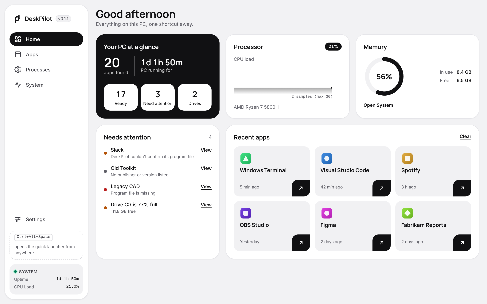
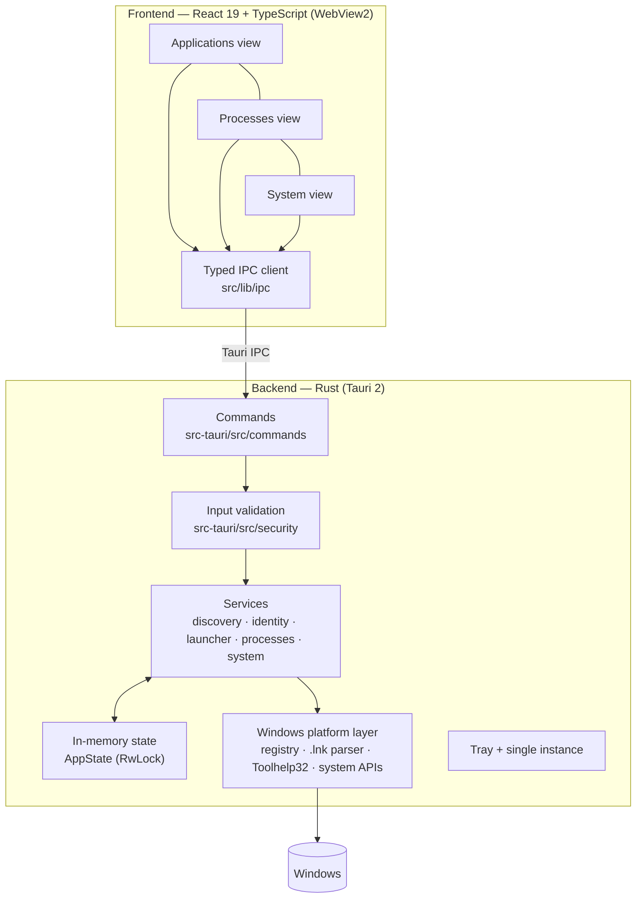

<p align="center"></p>

# DeskPilot

**A local-first Windows desktop command center: find and launch installed applications, inspect running processes, and monitor system resources — without accounts, cloud services, or telemetry.**


> [!IMPORTANT]
> **v0.1.1 is a developer preview.** Release binaries are **unsigned**, are **not publicly downloadable** (they are held in a private draft release), and have **not been validated on Windows 10** or on a clean physical machine. To try DeskPilot today, [build it from source](#building-from-source). See [Known limitations](#known-limitations) before use.

---

## Contents

- [Status at a glance](#status-at-a-glance)
- [Unreleased: UI redesign](#unreleased-ui-redesign)
- [Features](#features)
- [What DeskPilot does not do](#what-deskpilot-does-not-do)
- [System requirements](#system-requirements)
- [Installation](#installation)
- [Privacy and network behavior](#privacy-and-network-behavior)
- [Security model](#security-model)
- [Architecture](#architecture)
- [Testing and validation](#testing-and-validation)
- [Building from source](#building-from-source)
- [Known limitations](#known-limitations)
- [Roadmap](#roadmap)
- [Contributing](#contributing)

---

## Status at a glance

| Area | Status |
| :--- | :--- |
| Version | `0.1.1` developer preview (tag `v0.1.1-preview` → commit `0772d46`) |
| Code signing | Not signed. No signing date scheduled. |
| Public download | Not available. Artifacts exist only in a private draft release. |
| Windows 11 x64 | Ran successfully inside **Windows Sandbox** (silent MSI install, launch, core flows, shutdown). On the developer's own Windows 11 host, Windows Application Control **blocked** the unsigned binary (error 4551). |
| Windows 10 x64 | **Not yet tested.** Expected to be compatible, not verified. |
| Windows on ARM64 | Not built, not tested. |
| Clean-machine install lifecycle | Pending. Lifecycle tests so far ran in Windows Sandbox only. |
| Automated tests | 175 frontend + 182 backend test cases defined; both suites gate the release build in CI. See [Testing and validation](#testing-and-validation). |

---

## Unreleased: UI redesign

The `main` branch contains a UI redesign that is **not part of the v0.1.1 release** and has **not yet been validated on Windows**. The status table above and the sections below describe v0.1.1.

- **New look:** monochrome design system with light and dark themes that follow Windows, fonts bundled locally, and plain wording throughout.
- **Home page:** PC summary, live CPU and memory, a "Needs attention" list, and Recent apps.
- **Apps:** search first, status chips and a source filter, a dense list with one Tab stop, and launch errors explained inline.
- **Quick launcher:** a global shortcut (default Ctrl+Alt+Space, changeable) opens a small search window from any app.
- **Settings:**
  - theme
  - launcher shortcut
  - start with Windows (one per-user startup entry)
  - recent apps on/off
  - glass effect (Windows 11 only, applied after restart)
- **Local data:** unlike v0.1.1, the redesign writes two small files (launch history and settings) and, only if you turn it on, one startup entry. See [PRIVACY.md](PRIVACY.md).

> The screenshots below were rendered from the app's real frontend code with **sample data** in a browser. They are not captures from a Windows installation and will be replaced after Windows testing.




---

## Features

This section describes the **v0.1.1 release**. For what is new on `main`, see [Unreleased: UI redesign](#unreleased-ui-redesign).

DeskPilot has three views — **Applications**, **Processes**, and **System Intelligence** — plus a system tray presence.

### Applications: discovery and launch

- **Discovery sources** — reads installed-application metadata from:
  - `HKLM\Software\Microsoft\Windows\CurrentVersion\Uninstall` (64-bit view)
  - `HKLM\Software\Wow6432Node\Microsoft\Windows\CurrentVersion\Uninstall` (32-bit view)
  - `HKCU\Software\Microsoft\Windows\CurrentVersion\Uninstall`
  - Common Start Menu (`%ProgramData%\Microsoft\Windows\Start Menu\Programs`) and per-user Start Menu (`%APPDATA%\Microsoft\Windows\Start Menu\Programs`) `.lnk` shortcuts
- **Shortcut parsing in Rust** — `.lnk` files are parsed by a bounded binary parser (64 KiB read limit, Shell Link CLSID check, UTF-16LE and ANSI path support). No COM or shell handlers are invoked, and nothing is executed during discovery.
- **Deduplication with stable IDs** — entries found in several sources are merged under a deterministic `app_<32 hex>` identifier (first 128 bits of a SHA-256 over normalized publisher, name, and executable metadata). Each entry keeps a list of the sources it was found in.
- **Availability states** — each entry is classified at scan time as `Available`, `Unverified`, `IncompleteMetadata`, or `MissingTarget`. A **Refresh** action re-runs discovery; overlapping scans are prevented.
- **Partial-failure reporting** — inaccessible registry keys or folders are reported as non-fatal warnings with sanitized messages instead of aborting the scan.
- **Search** — instant, keyboard-first filtering ranked in four tiers: exact name → name prefix → name substring → publisher match. `Ctrl+K` focuses search, arrow keys move the selection, `Enter` launches, `Esc` clears.
- **Launching** — only entries in the `Available` state can be launched, and only after the backend re-validates the target:
  - the target must be an existing local `.exe` file (UNC, device, and NT-namespace paths are rejected);
  - the path is canonicalized and checked for consistency with the catalog record;
  - executables in `%TEMP%`/`%TMP%`, Windows temp folders, or `%USERPROFILE%\Downloads` are refused;
  - the process is started directly with Rust's `std::process::Command` (no `cmd.exe`/PowerShell, no command-line arguments), with its working directory set to the executable's folder;
  - applications run with the user's normal privileges. If an application requires elevation (`ERROR_ELEVATION_REQUIRED`, 740), DeskPilot shows a permission message rather than prompting for elevation.

### Processes: read-only monitor

- Enumerates running processes with a Toolhelp32 snapshot on a background thread, refreshed on demand.
- Shows PID, parent PID, name, executable path, start time, working-set memory, session ID, and **cumulative CPU time** (total kernel + user time since the process started). This is *not* a live CPU-percentage reading.
- Queries each process with `PROCESS_QUERY_LIMITED_INFORMATION` only. Processes that can't be fully read are labeled `partial`, `handleUnavailable`, or `exited` instead of failing.
- Sortable columns and a detail inspector. Lists are capped at 2,000 entries, with a visible notice when truncated.
- **Read-only.** DeskPilot cannot end, suspend, or modify processes; no such command exists in the backend.

### System Intelligence

- **CPU** — system-wide utilization calculated from the difference between successive `GetSystemTimes` samples, with a short history sparkline.
- **Memory** — total, available, and in-use physical memory (`GlobalMemoryStatusEx`).
- **Storage** — size, free space, and usage for fixed drives only (`GetDriveTypeW` = fixed; removable, optical, and network drives are excluded).
- **Uptime** — system uptime (`GetTickCount64`) and DeskPilot session duration.
- Refresh modes: manual, every 3 s, or every 5 s (default 5 s).

### Desktop integration

- **Single instance** — launching DeskPilot again focuses the existing window (via `tauri-plugin-single-instance`).
- **System tray** — tray menu with *Show DeskPilot*, *Hide DeskPilot*, and *Quit DeskPilot*. Closing the window hides it to the tray; *Quit* exits.
- Default window 960×680, minimum 520×450.

<!--
Screenshots: deskpilot_overview.png and deskpilot_search.png in docs/screenshots/ were
captured from v0.1.0. The redesign_*.png images are sample-data renders of the unreleased
redesign (shown above). Recapture both from real Windows builds before a release.
-->

---

## What DeskPilot does not do

To set accurate expectations for this preview:

- **No process termination**, suspension, or priority changes.
- **No Microsoft Store / MSIX / UWP app discovery** — only registry uninstall entries and Start Menu shortcuts.
- **No launch arguments**, no "run as administrator", no launching from Downloads or temp folders.
- **No saved settings or history** — the catalog and all metrics live in memory and are discarded on exit.
- **No auto-update**, accounts, cloud sync, analytics, or telemetry.
- **No global hotkey** — `Ctrl+K` works only while the DeskPilot window has focus.
- **No ARM64 build.**

---

## System requirements

| Requirement | Details |
| :--- | :--- |
| Operating system | Windows 11 x64. Windows 10 x64 is expected to work but is **untested**. |
| WebView2 Runtime | Microsoft Edge WebView2 (Evergreen). Included with Windows 11; often, but not always, present on Windows 10. The installer adds it if missing — see below. |
| Install permissions | Administrator rights (the MSI installs per-machine). |
| Security policy | Your system must permit running **unsigned** software. Hosts enforcing Smart App Control or App Control for Business may block DeskPilot. |

---

## Installation

> [!NOTE]
> Release artifacts are not currently published for public download. This section documents the behavior of the v0.1.1 MSI for evaluators who have been given access, and for anyone building the installer from source.

### Installer behavior

- **Package:** `deskpilot_0.1.1_x64_en-US.msi` (WiX), per-machine install to `C:\Program Files\deskpilot`.
- **Creates:** Start Menu shortcut, Desktop shortcut, an uninstall shortcut in the Start Menu folder, and one *Installed apps* entry.
- **Tested (Windows Sandbox only):** silent install (`msiexec /i … /qn`), upgrade from v0.1.0, repair (`msiexec /fa`), and uninstall (`msiexec /x`). The interactive installer wizard was **not** tested.

### WebView2 runtime

The MSI embeds Microsoft's WebView2 **bootstrapper** (not the full runtime) and runs it silently during setup:

- If the WebView2 Runtime is already installed, setup completes **without network access**.
- If it is missing, the bootstrapper **downloads the runtime from Microsoft** — an internet connection is required in that case.

### Unsigned binaries, SmartScreen, and Application Control

`Get-AuthenticodeSignature` reports `NotSigned` for v0.1.1 binaries. As a result:

- **SmartScreen** may show *"Windows protected your PC"* / *Unknown publisher*.
- **Smart App Control / App Control for Business** may block DeskPilot outright, without an override prompt. This happened on the developer's Windows 11 host (error 4551, Code Integrity events 3033/3077).
- Signing would establish publisher identity, but would not by itself guarantee that every App Control policy permits the app.

**Do not disable SmartScreen, Smart App Control, or organizational App Control policies to run DeskPilot.** If your policy requires signed software, wait for a signed release or evaluate from source in an environment where that is permitted.

### Verifying a download

Obtain binaries only from this repository. Verify the SHA-256 before running:

```powershell
Get-FileHash -Algorithm SHA256 .\deskpilot_0.1.1_x64_en-US.msi
```

| File | Size (bytes) | SHA-256 |
| :--- | ---: | :--- |
| `deskpilot_0.1.1_x64_en-US.msi` | 4,149,248 | `8d05ed157bbc6660f97f48bf1b00f5c44d0c096f1aecffd7f085449df7e9578e` |
| `deskpilot.exe` (standalone) | 4,613,632 | `12be660a18f48f1451531dd0723b31839e7b625ee5835bcfe77ad1a27a65e26f` |

Digests are from GitHub Actions run `43790285367` (commit `0772d46`). The `deskpilot.exe` **installed by the MSI** has a different hash (`52e641f0…425333a`) because the Tauri bundler stamps a 3-byte package-type marker into the MSI copy; code sections are identical. Full details and the remaining artifact hashes are in the [release notes](RELEASE_NOTES_v0.1.1_PREVIEW.md#4-cryptographic-checksums--artifact-integrity).

### Upgrading and downgrading

- Installing v0.1.1 over v0.1.0 performs a standard major upgrade (tested in Sandbox).
- The v0.1.1 installer includes a downgrade guard, but **the older v0.1.0 MSI does not. Do not run the v0.1.0 MSI over v0.1.1** — in testing it downgraded the installation without warning.

### Uninstalling

Uninstall from **Settings → Apps → Installed apps**, or:

```powershell
msiexec /x deskpilot_0.1.1_x64_en-US.msi
```

This removes the program files, shortcuts, and the *Installed apps* entry. **WebView2 profile data is left behind** at `%LOCALAPPDATA%\com.deskpilot.app\EBWebView` (about 8 MB in testing). Delete that folder manually for a complete removal.

---

## Privacy and network behavior

**DeskPilot's own code** (Rust backend and React frontend):

- implements no HTTP/WebSocket client, analytics, telemetry, crash reporting, or update check;
- in v0.1.1, writes no database, configuration file, or log file — all state is in memory and discarded on exit. The unreleased redesign on `main` adds a small launch-history file, a settings file, and an optional per-user startup entry (see [PRIVACY.md](PRIVACY.md));
- serves its UI from assets embedded in the executable, under a Content Security Policy that only allows same-origin resources.

**Components DeskPilot depends on behave independently:**

- **WebView2 Runtime** is a Microsoft component that is updated and managed by Windows/Edge and may make its own network connections under Microsoft's policies. It also stores profile data in `%LOCALAPPDATA%\com.deskpilot.app\EBWebView`.
- **The installer** may download the WebView2 Runtime if it is absent (see [Installation](#webview2-runtime)).
- **Applications you launch** run as independent processes with their own network and data behavior.

Short interactive test sessions observed no open TCP/UDP sockets from DeskPilot. That is an observation, not a guarantee about WebView2 or Windows behavior across all configurations. See [PRIVACY.md](PRIVACY.md) for details.

---

## Security model

The web UI is treated as untrusted; the Rust backend decides what is allowed.

| Control | Implementation |
| :--- | :--- |
| Minimal IPC surface | Six typed commands: app status, intent validation, discover applications, launch application, list processes, get system metrics. |
| Minimal WebView permissions | Tauri capability set is `core:default` only — no filesystem, shell, or opener plugins. |
| Content Security Policy | `default-src 'self'; script-src 'self'; style-src 'self' 'unsafe-inline'; img-src 'self'; object-src 'none'; base-uri 'self';` |
| Opaque application IDs | The UI receives application IDs, names, publishers, versions, sources, and availability — not executable paths. Launch requests carry only an ID, validated as `app_` + 32 lowercase hex characters. |
| No shell execution | Processes are created directly without `cmd.exe`/PowerShell and without arguments. |
| Launch-target validation | See [Launching](#applications-discovery-and-launch): local `.exe` only, canonicalized, temp/Downloads refused, re-checked at launch. |
| Least-privilege process queries | `PROCESS_QUERY_LIMITED_INFORMATION` only; no write or terminate access is requested. |
| Error sanitization | Backend errors are mapped to structured codes with messages stripped of filesystem paths and OS internals. |

**Scope of assurance:** these controls are backed by code review, unit/integration tests, and short sandboxed sessions (roughly 4–11 minutes). DeskPilot has **not** had a third-party penetration test, binary exploit analysis, or long-duration stability testing (multi-day runs, sleep/resume, memory pressure).

---

## Architecture



### Technology stack

| Layer | Technology |
| :--- | :--- |
| Desktop shell | Tauri 2 (WebView2 on Windows) |
| Backend | Rust (edition 2024), `windows-sys`, `winreg`, `sha2`, `serde` |
| Frontend | React 19, TypeScript 6, Vite 8 |
| Tests | Vitest + Testing Library + jsdom; Rust built-in test harness |
| Installer | WiX Toolset 3.14 (MSI) with embedded WebView2 bootstrapper |
| CI | GitHub Actions, `windows-2022`, manually dispatched release workflow |

More detail: [docs/ARCHITECTURE.md](docs/ARCHITECTURE.md).

---

## Testing and validation

DeskPilot distinguishes **automated tests** (logic verified without a real desktop) from **runtime validation** (the actual app running on Windows). Passing automated tests do not imply the GUI was exercised.

### Automated tests

| Suite | Runner | Test cases defined | Where |
| :--- | :--- | ---: | :--- |
| Frontend components and IPC contracts | Vitest (jsdom) | 175 in 13 files | `src/components/__tests__`, `src/lib/ipc/__tests__` |
| Backend unit tests | `cargo test` | 144 | `#[cfg(test)]` modules in `src-tauri/src` |
| Backend integration tests | `cargo test` | 38 in 3 files | `src-tauri/tests` |

The release workflow ([`build-release.yml`](.github/workflows/build-release.yml)) runs `npm test` and `cargo test --locked` as gates before building the MSI; any failure stops the build. The workflow runs on manual dispatch only — it is not triggered by pushes or pull requests.

These suites run headless (jsdom for the UI; the Rust harness for the backend). They verify logic, parsing, validation, state handling, and IPC contracts. They do **not** render the real WebView2 window, exercise the installer, or test behavior under Windows security policies.

### Runtime validation (manual)

| Scenario | Result |
| :--- | :--- |
| Windows 11, Windows Sandbox: silent install → launch → catalog search → process list → system metrics → single-instance focus → shutdown | ✅ Passed |
| Windows 11, Sandbox: launching DeskPilot itself and `cmd.exe` through the launcher | ✅ Passed |
| Windows 11, Sandbox: launching third-party GUI apps from the catalog | ⚠️ Not verified (Sandbox image lacked suitable apps) |
| Windows 11, Sandbox: install, upgrade from v0.1.0, repair, uninstall | ✅ Passed |
| Windows 11, Sandbox: interactive (non-silent) installer wizard | ⚠️ Not tested |
| Windows 11 developer host with App Control enforced | ❌ Blocked (error 4551, unsigned binary) |
| Windows 10 (physical or VM) | ⏳ Pending |
| Clean physical machine, full install lifecycle | ⏳ Pending |

Sandbox screenshots and verbose MSI logs were lost when the disposable Sandbox closed; the results above rest on recorded commands, exit codes, and UI Automation output. Full details are in the [release notes](RELEASE_NOTES_v0.1.1_PREVIEW.md).

---

## Building from source

### Prerequisites

| Tool | Version |
| :--- | :--- |
| Windows | 10 or 11, x64 |
| Node.js / npm | CI uses Node **24.15.0** / npm **11.12.1** |
| Rust | MSVC toolchain `x86_64-pc-windows-msvc`. Edition 2024 requires **1.85 or newer**; CI uses **1.99.1**. |
| C++ build tools | Visual Studio 2022 Build Tools with MSVC v143 and a Windows 10/11 SDK |
| WebView2 Runtime | Required to run the app |
| WiX Toolset 3.14 | Only to build the MSI (`tauri build`) |

### Commands

On systems where PowerShell's execution policy blocks `npm`, use `npm.cmd` instead.

```powershell
git clone https://github.com/youssefmanssouri/deskpilot-.git
cd deskpilot-
npm ci
```

```powershell
# Run the desktop app in development mode (hot reload)
npm run tauri dev
```

```powershell
# Frontend tests
npm test
```

```powershell
# Backend tests
cargo test --locked --manifest-path src-tauri/Cargo.toml
```

```powershell
# Type-check and build the web bundle
npm run build
```

```powershell
# Build the release executable and MSI
npm run tauri -- build --bundles msi
```

> [!NOTE]
> On machines enforcing Smart App Control or App Control for Business, locally compiled, unsigned build-script executables may be blocked, causing `cargo test` or `tauri dev` to fail. The CI workflow is the reference environment for backend tests.

### Project structure

```text
src/                     React frontend
  components/            Views, inspectors, hooks (+ __tests__)
  lib/ipc/               Typed IPC client and error types (+ __tests__)
src-tauri/
  src/commands/          IPC command handlers
  src/core/              Discovery, identity, launcher, process and system services
  src/platform/windows/  Registry, .lnk, Toolhelp32 and system API access
  src/security/          Input validation
  src/state/             In-memory application state
  src/tray/              System tray
  tests/                 Rust integration tests
  wix/main.wxs           MSI template
docs/                    Architecture notes and screenshots
```

---

## Known limitations

- **Unsigned binaries** — expect SmartScreen warnings; App Control policies may block execution.
- **Windows 10 untested**; **no clean physical-machine lifecycle test** yet.
- **Third-party app launching** from the catalog is unverified in Sandbox runs.
- **v0.1.0 → downgrade risk** — do not run the v0.1.0 MSI over v0.1.1.
- **Leftover WebView2 data** after uninstall in `%LOCALAPPDATA%\com.deskpilot.app\EBWebView`.
- **Store/MSIX apps not discovered.**
- **Availability is a scan-time snapshot**; use **Refresh** after installing or removing software.
- **Process CPU column shows cumulative CPU time**, not current CPU usage.
- **No third-party security audit** and no long-duration stability testing.

---

## Roadmap

Planned, **not implemented**:

- Safe local file operations (Recycle Bin–based deletes with rollback)
- Optional local persistence (SQLite) and an operation audit trail
- Authenticode code signing
- Windows 10 and clean-machine validation

No dates are committed.

---

## Contributing

Bug reports and pull requests are welcome via [GitHub Issues](https://github.com/youssefmanssouri/deskpilot-/issues).

- For bugs, include your Windows version and build, whether WebView2 was preinstalled, and any App Control/SmartScreen messages.
- Before opening a pull request, run `npm test`, `cargo test --locked --manifest-path src-tauri/Cargo.toml`, and `npm run build`.
- Keep the security model intact: the frontend must not gain filesystem, shell, or raw-path access, and launch requests must remain ID-based.

### Reporting security issues

Please do **not** open a public issue for vulnerabilities. Report them privately as described in [SECURITY.md](SECURITY.md).

---

## Documentation

- [Release notes — v0.1.1 preview](RELEASE_NOTES_v0.1.1_PREVIEW.md)
- [Privacy statement](PRIVACY.md)
- [Security policy](SECURITY.md)
- [Architecture](docs/ARCHITECTURE.md)
- [Third-party notices](NOTICES.md)

## License

[MIT](LICENSE) © 2026 DeskPilot Contributors
